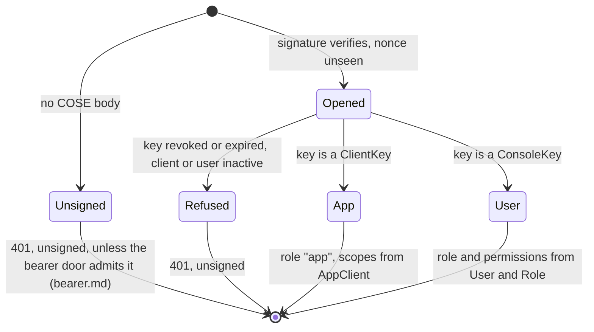

Turning a verified signature into a policy-evaluable identity.

Every `@@allow` in the schema resolves against the fields of the
`auth Principal` block — `sub`, `kind`, `role`, `appId`, and the two permission
claims `messageRead` and `optOutRead`. `hasRole('admin')` reads `role`;
`auth().kind == "app"` reads `kind`; `appId == auth().appId` reads `appId`.
[`Principal::into_context_granting`] is the single place those names are
produced, so a rename in the schema breaks exactly one function.

A policy can read a claim and cannot read `Role.permissions` or a scope, so a
read that must follow a permission is a claim. [`Grants::of`] projects the two
that are needed from the same `perms` and `scope` `require_permission` checks:
`messageRead` is `granted` when the caller holds `sms:read` (a person's role or
an app key's effective scope), and `optOutRead` when it holds `optout:read`. A
context built by [`Principal::into_context`] (the system's, a test's) is
`denied` on both. A claim is evaluated wherever the policy is, so `?include=`, a
relation filter, its `totalCount` and a nested include of a message from another
model are bound by it; a route gate cannot say that.

# VS-3, VSA-3b: two ways in, each verified before this runs

[`GatewayAuth`] is the generated router's one `AuthProvider`. It verifies
nothing itself: a layer above has already, and recorded the fact in the
request's extensions.

- the envelope layer (`crate::envelope`) opens the `COSE_Sign1` message, checks
  the signature and records a `VerifiedSigner`; [`GatewayAuth`] maps that signer
  through `crate::signers::SignerDirectory`;
- the bearer door (`crate::bearer`, VSA-3b, when `machine_tokens` or
  `human_login` is served) verifies a machine's or a person's token, resolves
  who it names **from rows**, and records a `BearerCaller` holding the same
  `Standing`.

Both end in one `GatewayAuth::context_for`, so no policy can tell the doors
apart. There is no JWKS to fetch here and the header is never read as an
identity: an `Authorization` header beside a verified signature is a 400, and one
the door did not record authenticates nobody. A request that carries both a
signer and a bearer caller is refused as well.

```mermaid
sequenceDiagram
    participant C as Caller
    participant E as Envelope layer
    participant D as SignerDirectory
    participant A as GatewayAuth
    participant R as Router (policies)
    C->>E: `COSE_Sign1` over the JSON payload
    E->>D: resolve kid (ClientKey, ConsoleKey: live rows only)
    D-->>E: public key(s) - or none, so 401 unsigned
    E->>E: verify, record (kid, cti), map to client:/user:
    E->>A: request + VerifiedSigner
    A->>D: standing(thumbprint)
    D-->>A: App(client, scopes) or User(role, perms)
    A-->>R: CratestackContext (sub, kind, role, appId; perms, scope)
    R-->>E: response
    E-->>C: `COSE_Sign1` over the response
```



Two signer kinds, one outcome each:

- a non-revoked `ClientKey` (Ed25519) of an active, unretired `AppClient` is an
  **app** principal: `sub = AppClient.clientId`, `role = "app"` (a sentinel that
  matches no `hasRole(...)` clause), `appId = AppClient.appId`, `scope =
  AppClient.scopes`, no `perms`;
- a non-revoked, unexpired `ConsoleKey` (ESP256) of an active `User` is a
  **user** principal: `sub = User.id`, `role = Role.key`, `perms` = the role's
  permissions, no `scope`. A role keyed `system` or `app` is refused
  ([`RESERVED_ROLE_KEYS`]).

A person's **access token** (VSA-4b) is the second route to the user principal,
the same `Standing::User` a console key gives: `sub = User.id`, the role's
`perms`, no `scope` (the token's OIDC `openid profile` is what the console may
read about the person, never fed to Layer 2). With one cap, applied by
[`refuse_device_only_role`]: a person whose role is in [`DEVICE_ONLY_ROLES`]
(`owner`, `admin`) is refused with a 403 ([`DEVICE_REQUIRED`]) behind a token,
and acts only from a paired console key. The function runs twice, deliberately:
in `SignerDirectory::bearer_standing`, where the standing is built, **after** the
cache read and on the value just read (the cache is shared with the signed door,
where an `admin` is legitimate, so that is what covers the cache), and in
[`GatewayAuth::authenticate`] on the standing the door recorded. The second is a
safety net, not the cache's cover: it catches the case where the first is ever
moved into the cache loader, and a standing that reached the provider any other
way. Keep both, and keep the first after the cache read.

A key's own revocation and expiry are read on every request, never cached. The
standing of its owner (`AppClient`, `User` and `Role`) is cached for 60
seconds, as the token-era lookups were, so a deactivated client or person
stops acting within one window.

`perms` and `scope` are Layer 2's vocabulary (`require_permission`); they live
in the context's `extensions`, not in `auth.fields`, so a typo'd extra can
never match a `hasRole(...)` clause it was never meant to. The two claims above
are the exception, projected on purpose and named in the schema's `auth` block.

# #71: this is also where the correlation id enters `CratestackContext`

`cratestack_core::CratestackContext::request_id`/`with_request_id` has existed
since before this milestone (`cratestack-core`'s own doc: "Surfaces in
tracing spans and is recorded on audit events"), and every generated
CRUD/procedure route already logs `cratestack_request_id =
ctx.request_id().unwrap_or("")` (`cratestack-macros`'s
`list_result_log_tokens`/`dispatch_tail.rs`) — but nothing in this
deployment ever called `with_request_id`, so that field had been empty
on every single one of those log lines since the router first existed.
[`GatewayAuth::authenticate`] is the one place a [`CratestackContext`] is
constructed per inbound HTTP request, so it is the natural, and only,
place to close that gap: honour an inbound `X-Request-Id` if the caller
sent one (so a client's own trace id survives into this system's logs
unchanged), otherwise mint a fresh one. Either way, every
`cratestack_*`-logged event for one HTTP request now shares one
`cratestack_request_id` — the correlation this crate's own custom
`message_id`-keyed events (`procedures.rs::send`) sit alongside, not a
replacement for them: a request id ties together everything logged
*within* this one process for *this* request; `message_id` is what
survives into `sms-worker`'s dispatch and the DLR ingestion path,
neither of which shares this process or this request. See
`docs/runbooks/alerting.adoc`'s own "Correlating a message end to end"
section for the worked example joining both.

<!-- markdownlint-disable-file MD041 -->
