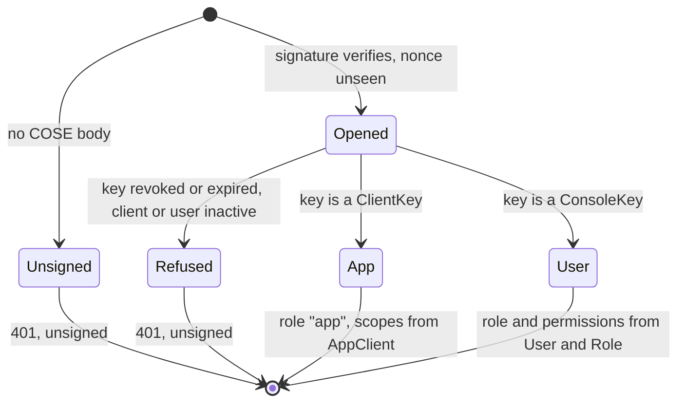

Turning a verified signature into a policy-evaluable identity.

Every `@@allow` in the schema resolves against the four fields of the
`auth Principal` block — `sub`, `kind`, `role`, `appId`. `hasRole('admin')`
reads `role`; `auth().kind == "app"` reads `kind`; `appId == auth().appId`
reads `appId`. [`Principal::into_context`] is the single place those names
are produced, so a rename in the schema breaks exactly one function.

# VS-3: the only credential is the key that signed the request

[`SignedAuth`] is the generated router's one `AuthProvider`. The envelope
layer (`crate::envelope`) opens the `COSE_Sign1` message, checks the signature
and records a `VerifiedSigner` in the request's extensions; [`SignedAuth`]
maps that signer through `crate::signers::SignerDirectory` and reads nothing
else. There is no token to validate, no JWKS to fetch, and an `Authorization`
header is refused with a 400 rather than ignored.

```mermaid
sequenceDiagram
    participant C as Caller
    participant E as Envelope layer
    participant D as SignerDirectory
    participant A as SignedAuth
    participant R as Router (policies)
    C->>E: `COSE_Sign1` over the JSON payload
    E->>D: resolve kid (ClientKey, ConsoleKey: live rows only)
    D-->>E: public key(s) - or none, so 401 unsigned
    E->>E: verify, record (kid, cti), map to client:/user:
    E->>A: request + VerifiedSigner
    A->>D: standing(thumbprint)
    D-->>A: App(client, scopes) or User(role, perms)
    A-->>R: CratestackContext (sub, kind, role, appId; perms, scope)
    R-->>E: response
    E-->>C: `COSE_Sign1` over the response
```



Two signer kinds, one outcome each:

- a non-revoked `ClientKey` (Ed25519) of an active, unretired `AppClient` is an
  **app** principal: `sub = AppClient.clientId`, `role = "app"` (a sentinel that
  matches no `hasRole(...)` clause), `appId = AppClient.appId`, `scope =
  AppClient.scopes`, no `perms`;
- a non-revoked, unexpired `ConsoleKey` (ESP256) of an active `User` is a
  **user** principal: `sub = User.id`, `role = Role.key`, `perms` = the role's
  permissions, no `scope`. A role keyed `system` or `app` is refused
  ([`RESERVED_ROLE_KEYS`]).

A key's own revocation and expiry are read on every request, never cached. The
standing of its owner (`AppClient`, `User` and `Role`) is cached for 60
seconds, as the token-era lookups were, so a deactivated client or person
stops acting within one window.

`perms` and `scope` are Layer 2's vocabulary (`require_permission`); they live
in the context's `extensions`, not in `auth.fields`, so a typo'd extra can
never match a `hasRole(...)` clause it was never meant to.

# #71: this is also where the correlation id enters `CratestackContext`

`cratestack_core::CratestackContext::request_id`/`with_request_id` has existed
since before this milestone (`cratestack-core`'s own doc: "Surfaces in
tracing spans and is recorded on audit events"), and every generated
CRUD/procedure route already logs `cratestack_request_id =
ctx.request_id().unwrap_or("")` (`cratestack-macros`'s
`list_result_log_tokens`/`dispatch_tail.rs`) — but nothing in this
deployment ever called `with_request_id`, so that field had been empty
on every single one of those log lines since the router first existed.
[`SignedAuth::authenticate`] is the one place a [`CratestackContext`] is
constructed per inbound HTTP request, so it is the natural, and only,
place to close that gap: honour an inbound `X-Request-Id` if the caller
sent one (so a client's own trace id survives into this system's logs
unchanged), otherwise mint a fresh one. Either way, every
`cratestack_*`-logged event for one HTTP request now shares one
`cratestack_request_id` — the correlation this crate's own custom
`message_id`-keyed events (`procedures.rs::send`) sit alongside, not a
replacement for them: a request id ties together everything logged
*within* this one process for *this* request; `message_id` is what
survives into `sms-worker`'s dispatch and the DLR ingestion path,
neither of which shares this process or this request. See
`docs/runbooks/alerting.adoc`'s own "Correlating a message end to end"
section for the worked example joining both.
