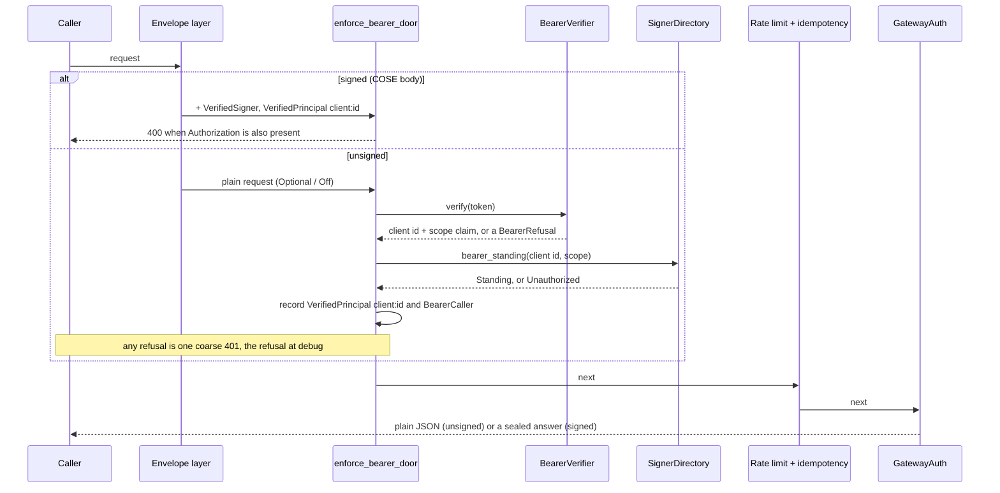
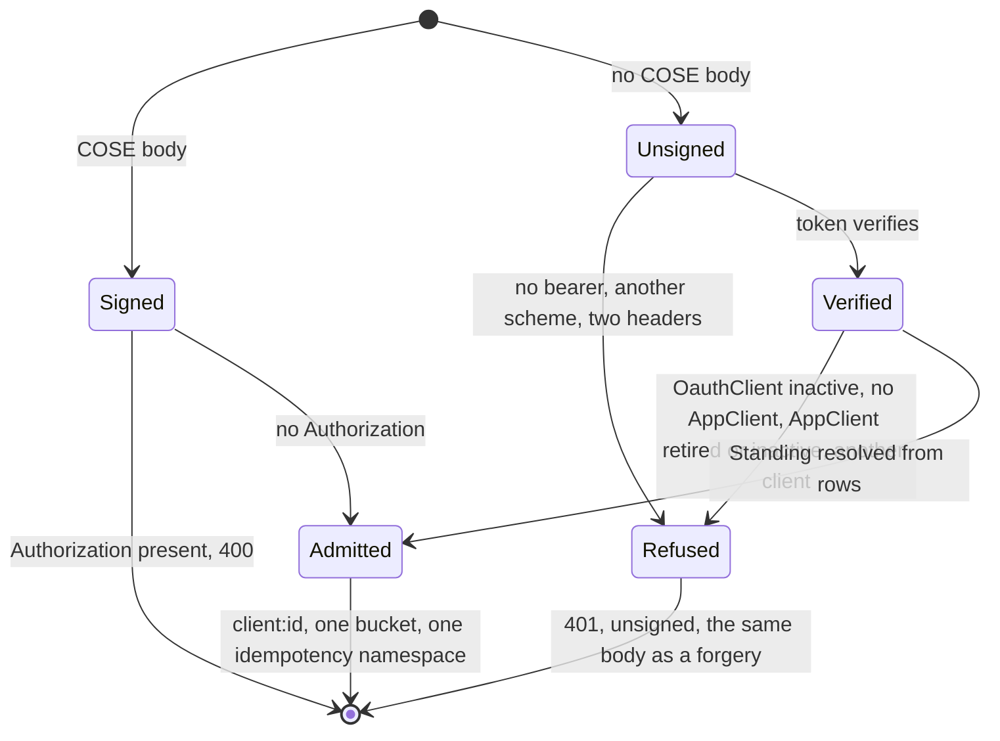

The second way in: a machine token beside the signed envelope (VSA-3b).

A deployment that serves `machine_tokens` (`auth.methods` permits it **and**
`op:` is written) mints tokens at `/token`, and this module is what lets the API
accept one. It is `Authorization: Bearer <token>` for a **machine client** and
nothing else: a person's token is refused ([`BearerRefusal::HumanToken`]) and
the human realm is VSA-4.

# The doors, and the mode each sets

[`ApiDoors`] is what `sms-gateway serve` reads from `auth.methods`: the signed
envelope (`keypair`), a token (`machine_tokens` served), or both. Neither is
refused at construction ([`NoDoor`]), the same refusal `ConfigError::NoWayIn`
makes at load.

| `keypair` | `machine_tokens` served | envelope mode | an unsigned request      | a signed request                    |
| --------- | ----------------------- | ------------- | ------------------------ | ----------------------------------- |
| on        | off                     | `Required`    | coarse 401, by the layer | opened and sealed                   |
| on        | on                      | `Optional`    | reaches the door         | opened and sealed                   |
| off       | on                      | `Off`         | reaches the door         | 415, by the layer (never forwarded) |

`crate::envelope::mode_for` is the table. Three settings do not follow it
(`crate::envelope::layer`): routes the layer cannot bind fail closed (`500`) in
every mode, because a bare `Optional` or `Off` policy would otherwise wave a
route it does not know through unsigned; an unsigned request's answer is
**never** sealed, whatever its `Accept` says; and the principal is named the
same way for both doors.

# What the door does

# What a token is, and is not

A token **names** a client; it never grants anything.

- **Scope is read from rows.** The client's scopes are `AppClient.scopes`. The
  token's `scope` claim only narrows them (their intersection), and
  `console:pair` is dropped whatever either side says: pairing a console key is
  a signed act (`docs/architecture.md` section 4.9). `perms` are not read from a
  token at all.
- **The audience must contain `sub`.** `authkestra` stamps `aud = client_id`
  unless the client asked for another audience, and one that did is not a token
  for this API.
- **Standing is read on every request.** `OauthClient.active` is not cached, so
  deactivating a client ends its tokens on the next call; the `AppClient`
  (`active`, not retired, same `clientId`) is cached for 60 seconds like the
  signed door's.
- **The two doors are one principal.** Both record `client:<clientId>`, so a
  caller that uses both shares one rate-limit bucket and one idempotency
  namespace: a request sealed once and replayed with a token (or the reverse)
  replays the stored answer.
- **A token caller gets plain JSON.** There is no response seal and no
  contract-lock 426, which only a sealed exchange carries; the contract lock
  protects phones that pinned an op's shape, and a token caller has pinned
  nothing.
- **A token is not a pairing credential.** `registerConsoleKey` is refused to
  it: the scope that would allow it never survives
  [`SignerDirectory::bearer_standing`].

# Why a trait

[`BearerVerifier`] is the seam between the claims (the gateway's, over the key
set the provider itself signs with: `sms-gateway`'s `op_bearer`) and what a
verified token may become (this crate's). It lets the door's tests run with a
verifier that needs no RSA key, and keeps `jsonwebtoken` out of this crate.

<!-- markdownlint-disable-file MD041 -- rustdoc sidecar: include_str!'d as module docs, so it opens with prose, not a heading; at the end so the first paragraph stays rustdoc's summary line -->
