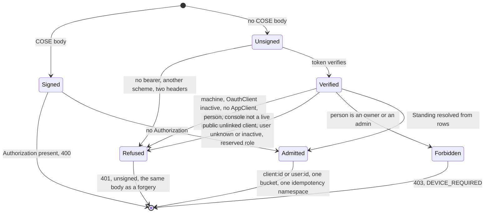

The second way in: a token beside the signed envelope (VSA-3b, and VSA-4b for a person).

A deployment that serves `machine_tokens` or `human_login` (`auth.methods`
permits it **and** its block is written) mints tokens at `/token`, and this
module is what lets the API accept one. It is `Authorization: Bearer <token>`
for two kinds of caller, told apart by the token's own `identity` claim and
each served or not by its own method:

- a **machine client** (`client_credentials`, no `identity`), when
  `machine_tokens` is served: [`VerifiedBearer::Machine`];
- a **person** (`authorization_code` after `POST /login`, an `identity` whose
  `external_id` is the `sub`), when `human_login` is served:
  [`VerifiedBearer::Person`]. They act as the `User` the token names, with the
  role their row says, **except** that an `owner` or an `admin` behind a
  person's token is a 403 ([`crate::auth::DEVICE_REQUIRED`]): those roles act
  only from a paired console key (a device), never from a password session.

A token of a realm that is not served is refused ([`BearerRefusal::HumanToken`]
where no person realm is served, [`BearerRefusal::MachineToken`] where only
people are), a person's **ID token** is refused ([`BearerRefusal::IdToken`]),
and a token bound to a key (a `cnf` claim) is refused
([`BearerRefusal::SenderConstrained`]) because this door checks no proof of it.

# The doors, and the mode each sets

[`ApiDoors`] is what `sms-gateway serve` reads from `auth.methods`: the signed
envelope (`keypair`), a token (`machine_tokens` or `human_login` served), or
both. Neither is refused at construction ([`NoDoor`]); `human_login` alone is
not a way in either, and `ConfigError::NoWayIn` refuses it at load. Which realms
the token door accepts is not the doors' business: it lives inside the one
[`BearerVerifier`], so the mode follows whether **any** token is accepted.

| `keypair` | a token served | envelope mode | an unsigned request      | a signed request                    |
| --------- | -------------- | ------------- | ------------------------ | ----------------------------------- |
| on        | no             | `Required`    | coarse 401, by the layer | opened and sealed                   |
| on        | yes            | `Optional`    | reaches the door         | opened and sealed                   |
| off       | yes            | `Off`         | reaches the door         | 415, by the layer (never forwarded) |

"A token served" is `machine_tokens` **or** `human_login`: `[keypair,
human_login]` is `Optional`, where before VSA-4b it was `Required` because no
token could be used.

`crate::envelope::mode_for` is the table. Three settings do not follow it
(`crate::envelope::layer`): routes the layer cannot bind fail closed (`500`) in
every mode, because a bare `Optional` or `Off` policy would otherwise wave a
route it does not know through unsigned; an unsigned request's answer is
**never** sealed, whatever its `Accept` says; and the principal is named the
same way for both doors.

# What the door does

```mermaid
sequenceDiagram
    participant C as Caller
    participant E as Envelope layer
    participant B as enforce_bearer_door
    participant V as BearerVerifier
    participant D as SignerDirectory
    participant L as Rate limit + idempotency
    participant A as GatewayAuth
    C->>E: request
    alt signed (COSE body)
        E->>B: + VerifiedSigner, VerifiedPrincipal client:id
        B-->>C: 400 when Authorization is also present
    else unsigned
        E->>B: plain request (Optional / Off)
        B->>V: verify(token)
        V-->>B: Machine(client id, scope) or Person(user id, console id), or a BearerRefusal
        B->>D: bearer_standing(claims)
        D-->>B: Standing, Unauthorized, or Forbidden (owner/admin by token)
        B->>B: record VerifiedPrincipal client:id or user:id, and BearerCaller
        Note over B,C: any refusal is one coarse 401, the refusal at debug; the one 403 is DEVICE_REQUIRED
    end
    B->>L: next
    L->>A: next
    A-->>C: plain JSON (unsigned) or a sealed answer (signed)
```



# What a token is, and is not

A token **names** a client or a person; it never grants anything.

- **Scope is read from rows.** A token acts with `AppClient.scopes` kept only
  where `OauthClient.scopes` also lists them: `/token` checks a *requested*
  scope against the `OauthClient` row, but a token that asks for none carries no
  claim, so the row is the ceiling here, not the claim. The token's `scope`
  claim, when present, narrows that further (their intersection), and
  `console:pair` is dropped whatever any side says: pairing a console key is a
  signed act (`docs/architecture.md` section 4.9). `perms` are not read from a
  token at all.
- **A machine's audience must contain `sub`.** `authkestra` stamps `aud =
  client_id` unless the client asked for another audience, and one that did is
  not a token for this API.
- **A person's audience is the console, alone.** The access token a code
  exchange mints is addressed to the console client (`aud = client_id`), and the
  one audience must be `human_login.console_client.client_id`: a list naming
  anyone else beside it is refused. `sub` is the `User.id`, and the `identity`
  claim must name the same account (`external_id == sub`), or the token was not
  minted by this provider.
- **An ID token is not an access token.** The provider stamps both with the
  same issuer, subject, audience, `identity`, key and lifetime, and the
  difference is only that the ID token has no `scope` (and a `nonce` when the
  sign-in sent one). The console hands that token to a browser, so it must not
  open the API: a person's token needs a non-blank `scope` and no `nonce`
  ([`BearerRefusal::IdToken`]). The test is a heuristic, because `authkestra`
  stamps no `typ`; the console's sign-in must ask for `openid profile`.
- **A person's standing is read from rows, too.** The console `OauthClient` is
  read on every request and must be active, public
  (`tokenEndpointAuthMethod = none`) and linked to no `AppClient` (so a machine
  client's id in the audience is refused); the `User` is active with a role that
  exists and is not reserved, read through the same 60-second cache a paired
  console key's owner is (so a deactivation or a promotion takes effect within
  one TTL, as it does for a key). Their OIDC `scope` is never read as
  permissions: the role's permissions decide, as for the key.
- **Owner and admin never act from a token.** A `User` has one role and
  `hasRole` matches one string, so a token cannot carry "the role minus the
  powerful part": [`crate::auth::DEVICE_ONLY_ROLES`] (`owner`, `admin`) are
  refused with a 403 and [`crate::auth::DEVICE_REQUIRED`], by
  [`crate::auth::refuse_device_only_role`] called from both
  [`SignerDirectory::bearer_standing`] and [`crate::auth::GatewayAuth`]. The
  cap is keyed on the credential (any person's token), not on the provider that
  minted it, so a future sign-in through another identity provider is capped
  the same.
- **Standing is read on every request.** `OauthClient.active` is not cached, so
  deactivating a client ends its tokens on the next call; the `AppClient`
  (`active`, not retired, same `clientId`) is cached for 60 seconds like the
  signed door's.
- **The two doors are one principal.** Both record `client:<clientId>` for a
  machine and `user:<User.id>` for a person (their console key's name), so a
  caller that uses both shares one rate-limit bucket and one idempotency
  namespace: a request sealed once and replayed with a token (or the reverse)
  replays the stored answer.
- **A token caller gets plain JSON.** There is no response seal and no
  contract-lock 426, which only a sealed exchange carries; the contract lock
  protects phones that pinned an op's shape, and a token caller has pinned
  nothing.
- **A token is not a pairing credential.** For a machine, `registerConsoleKey`
  is refused to it: the scope that would allow it never survives
  [`SignerDirectory::bearer_standing`]. For a person, the roles that
  administer people and clients are the device-only ones above, so a password
  session cannot reach it either.

# Why a trait

[`BearerVerifier`] is the seam between the claims (the gateway's, over the key
set the provider itself signs with: `sms-gateway`'s `op_bearer`) and what a
verified token may become (this crate's). It lets the door's tests run with a
verifier that needs no RSA key, and keeps `jsonwebtoken` out of this crate.

<!-- markdownlint-disable-file MD041 -- rustdoc sidecar: include_str!'d as module docs, so it opens with prose, not a heading; at the end so the first paragraph stays rustdoc's summary line -->
