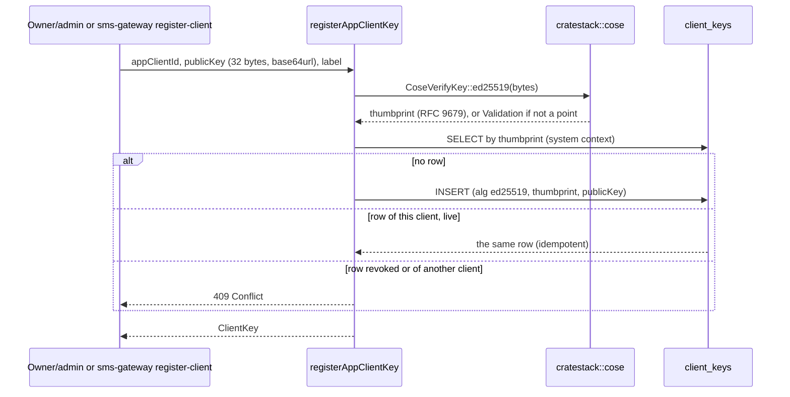
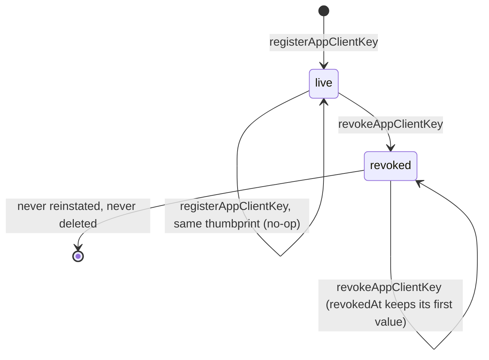

The request-signing public keys of an app client (signed transport, VS-2).

`registerAppClientKey` and `revokeAppClientKey` are the only writers of the
`ClientKey` model. **Nothing verifies against those rows yet**: VS-3 mounts
the envelope layer and a database-backed resolver over this table. Until then
a key registered here is recorded intent, and `provisionAppClient`, the RSA
keys and the token server are untouched.

# Why the writes run as `system`

`ClientKey`'s `create` and `update` policies are `hasRole('system')` only. A
human `owner` or `admin` cannot plant a row through the generated
`POST /client_keys`, which would skip the thumbprint computation and the key
validation above; the two procedures, each `@allow(owner || admin)`, run the
write under [`crate::auth::system_context`]. `ClientKey.read` admits owner,
admin and system (VS-3's resolver). `AppClient` is the same arrangement:
`provisionAppClient` is its sole writer.

# What a thumbprint is here

`ClientKey.thumbprint` is the RFC 9679 COSE key thumbprint of the Ed25519 key,
lowercase hex, computed by `cratestack::cose` (never re-implemented and never
caller-supplied). It is the key's identity: unique across the table, and its
first 16 hex characters are the 8-byte `kid` a signed request carries.

<!-- markdownlint-disable-file MD041 -->
