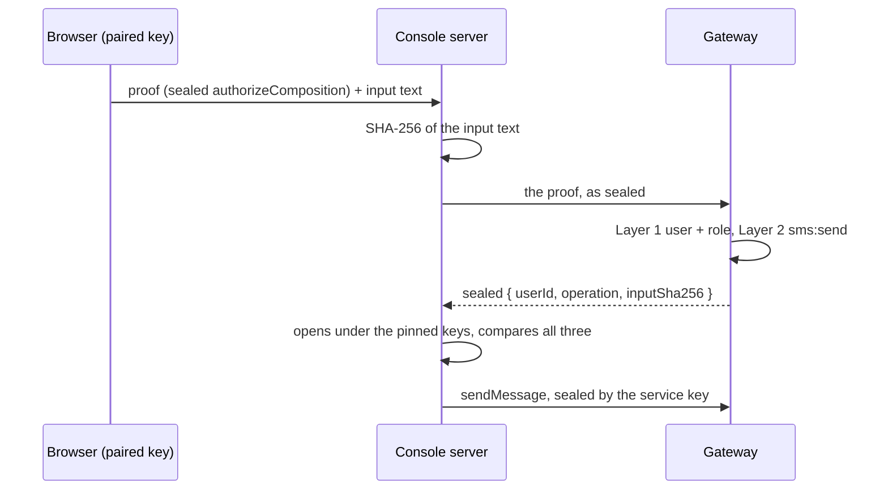

`authorizeComposition`: the gateway's statement that the person behind a
sealed request may send, and may send *this*.

The operator console composes a message in the browser and sends it through a
service key held by its server, because `sendMessage` and `previewMessage` take
the sending `App` from an app caller. A standing key must not be spent on
whoever reaches the composer's route, and the one thing the gateway can say
about a caller is who signed. So the browser seals a call to this procedure
with its paired key, naming the operation and the SHA-256 of the exact input it
will post, and the console's server forwards the bytes and believes only a
sealed answer that names a person.

Why a procedure, and why not a read the person is allowed to make:

- Every signer the envelope accepts gets a `200` from a read the policy
  admits. `SenderId` is readable by `kind == "user"` and by `kind == "app"`, so
  a proof that was "a sealed read answered 200" was equally true for any
  `AppClient`'s key of any app, and for an auditor.
- A denied list is an empty array with a `200`; a denied procedure is a `403`.
  Nothing here can be satisfied by a refusal reading as a success.

Layer 1 (`@allow` in the schema) admits a `user` holding `owner`, `admin` or
`operator`, the roles `sendMessage` admits for a human. Layer 2 is
`require_permission(ctx, "sms:send")`, so a role whose permissions lost the
literal is refused even at a role Layer 1 admits. [`authorize`] repeats the
`user` check because a procedure is also callable in process, where the
`@allow` is the caller's to run.

The answer carries nothing the caller did not send except the person: the
operation and the hash are echoed so the console compares what the gateway
authorized with what it is about to send, and a proof sealed for one message
cannot send another. Single use is the envelope's: its nonce is recorded in
`EnvelopeNonce` and a second presentation is refused before this runs.
