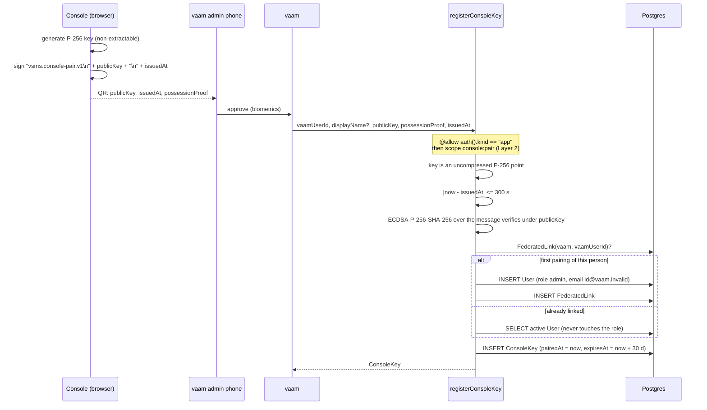
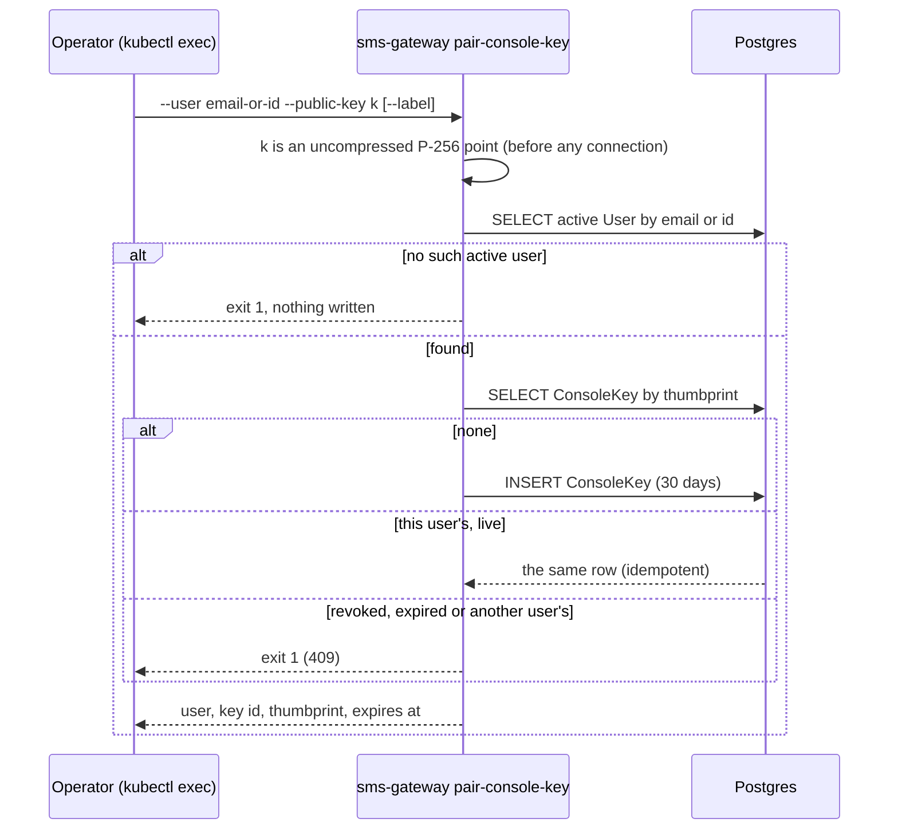
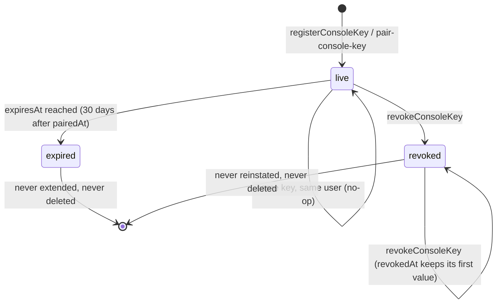

The request-signing public keys of a human's console (signed transport, VS-5a).

`registerConsoleKey`, `revokeConsoleKey` and `sms-gateway pair-console-key` are
the only writers of the `ConsoleKey` model. **Nothing verifies against those
rows yet**: VS-3 gives the envelope `AuthProvider` its second signer kind
(`ConsoleKey` -> user principal, beside `ClientKey` -> app principal). Until
then a key registered here is recorded intent, and the password login, the
Keycloak SSO and the OP's tokens are untouched (they go in VS-4).

A console key is a `WebCrypto` **non-extractable P-256 key** (ESP256, COSE `-9`).
`ConsoleKey.publicKey` is its **SEC1 uncompressed point**, 65 bytes
(`0x04 || X || Y`): what `crypto.subtle.exportKey("raw", publicKey)` returns,
what `CoseVerifyKey::p256_sec1` accepts and `p256_sec1_uncompressed` returns.
A compressed point is a valid key in a second spelling and is refused, not
normalised. On the wire it is base64url without padding.

# Pairing through vaam

vaam is the only identity source: a person is a vaam admin on a bound phone,
and that phone's approval is what makes vaam call `registerConsoleKey` with its
service client (an app principal holding scope `console:pair`, an ordinary
`AppClient` scope registered by `sms-gateway register-client --scope
console:pair`). vsms never sees the phone; it checks the one thing vaam cannot
vouch for, that the browser holds the private half.

The order inside `register` is the order an attacker learns least in: the
scope is refused before any signature work, a stale request before the
signature is looked at, and a bad signature before the database is touched, so
a refused pairing writes nothing (no `User`, no link).

**The role is `admin`, never `owner`** (owner ruling R2). Two independent
things hold it, and the tests break each: `PAIRED_ROLE` is `admin`, and the
`User` row is written under a context whose role is the literal `admin`, the
weakest role `User.create` admits, so that policy's own `roleKey != 'owner'`
clause refuses `owner` even if the constant were edited. A person who is
already linked keeps whatever role they have: pairing never changes a role in
either direction. A deactivated or deleted account is refused (403), not
resurrected.

The person has no email at vsms, and `User.email` is required and unique, so
the row gets `<vaamUserId>@vaam.invalid` (`.invalid` is reserved by RFC 2606
and never resolves). `User.subject` is the row's own id, as everywhere else.

# Break-glass: `sms-gateway pair-console-key`

There is no proof of possession: the operator who can run this against the
database already holds more authority than a pairing grants (the reasoning of
`provision-user`). So it is bounded the other way: it creates no user and
changes no role, so it cannot mint an owner, and it needs `--user` to exist.
It can attach a key to an existing owner, which is the point: the owner locked
out of the console with no vaam admin phone gets back in.

# Life of a key

* **Expiry is data, not a job.** `expiresAt` is `pairedAt + 30 days` (owner
  ruling R3), set once. Nothing sweeps it; VS-3's resolver must treat
  `expiresAt <= now` and `revokedAt IS NOT NULL` as no key. The console pairs
  again with a new key rather than extending one, so a stolen browser profile
  has a bounded life even if nobody notices.
* **Revoke, never delete.** The row stays, so a revoked or expired thumbprint
  cannot be registered again as a fresh key.
* **Who revokes.** `revokeConsoleKey` is `@allow(auth().kind == "user")` plus
  `@authorize(ConsoleKey, detail, args.keyId)`: the generated `ConsoleKey`
  read policy decides, so an owner or admin revokes any key and anyone else
  only their own. An admin can therefore revoke an owner's key; the owner
  re-enrols with the break-glass command.

# Why the writes run as `system`

`ConsoleKey`'s `create` and `update` are `hasRole('system')` only. A human
`owner` or `admin` cannot plant a row through the generated `POST
/console_keys`, which would skip the key validation, the proof and the
thumbprint computation. The procedures run the write under
[`crate::auth::system_context`]; the `User` row of a first pairing is the one
write that runs as a human-shaped context (`User.create` has no `system`
clause), and the `FederatedLink` is system-only like its model.

# What a thumbprint is here

`ConsoleKey.thumbprint` is the RFC 9679 COSE key thumbprint of the P-256 key
(`{1: 2, -1: 1, -2: x, -3: y}`, SHA-256), lowercase hex, computed by
`cratestack::cose` and never taken from the caller. It is unique across the
table, and its first 16 hex characters are the 8-byte `kid` a signed request
carries.

# What the proof of possession does and does not prove

It proves the caller held the private half when it signed `issuedAt` within
the last five minutes. It does not bind `vaamUserId`: vaam is trusted for who
the person is, which is exactly why only a service holding `console:pair` may
call. A high `s` is accepted (`WebCrypto` does not normalise it), and a proof
may be replayed inside its window, which is harmless: the registration is
idempotent on the thumbprint.

<!-- markdownlint-disable-file MD041 -->
