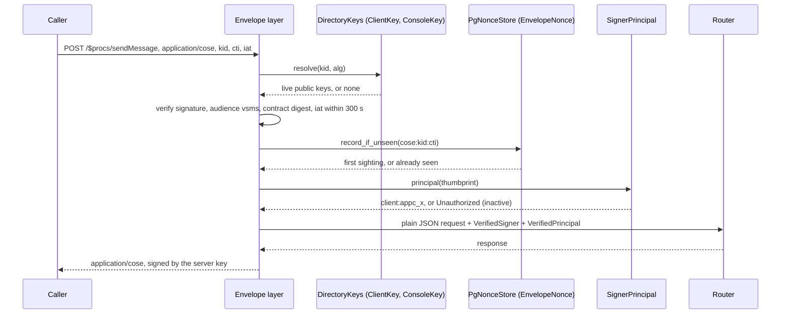
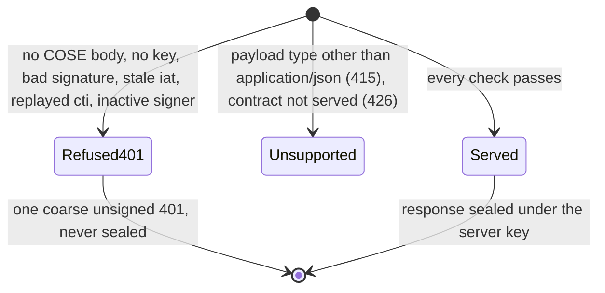

The signed transport's server half (VS-3): the `COSE_Sign1` envelope layer that
opens every request and seals every response of the generated router.

The layer proves *who holds the key*; it authenticates no one. What a key may
do is [`crate::signers::SignerDirectory`]'s answer, read by
[`crate::auth::GatewayAuth`]. This module is the Postgres-backed plumbing the
layer needs:

- [`ServerKeys`]: the Ed25519 key that seals every response, and the `next`
  key clients already pin so a rotation needs no flag day. Both are PKCS#8 PEM
  files (`openssl genpkey -algorithm ed25519`); `sms-gateway serve` refuses to
  boot without them or with the same key twice.
- [`PgNonceStore`]: the replay cache. cratestack keeps `(kid, cti)` until
  `iat + 2 * skew + 1`; the in-memory store is per process and this deployment
  has no Redis, so the cache is the `EnvelopeNonce` table, written through the
  generated delegates, and swept by the worker (`sweep_envelope_nonces`).
- [`SignerPrincipal`]: names the principal a verified request is charged to
  (`client:<clientId>` or `user:<id>`) and refuses an inactive signer.
- [`layer`]: assembles the above with `Required` for every op.

# One answer for every verification failure

A forgery, a revoked or expired key, a replayed `cti`, a stale `iat` and an
inactive client or person all get the same unsigned 401 with the same body.
A replay in particular must not earn a *signed* 401 for a request that already
executed. This is also why the resolver ([`crate::signers::DirectoryKeys`])
stops resolving a revoked key instead of keeping it resolving to seal a
"you were revoked" answer, as a service with a long-lived phone key might: the
caller holding a revoked key learns only that it no longer works.

# Payload type: JSON only

The router's codec is JSON, so the layer is built with
`payload_media_types(["application/json"], ["application/json"])`. A client
names it in `Cratestack-Payload-Type` and asks for it in
`Cratestack-Payload-Accept`; a request that names nothing means CBOR, which is
outside the set and is refused with a 415 before any key is looked up.

# What is outside the layer

`/dlr/{providerKey}` (providers cannot sign and authenticate themselves),
`/healthz` and `/readyz`. (Until VS-4 the OP routes, `/token`, `/jwks.json`,
discovery, `/login*` and `/login/sso/*`, were here too; they are deleted and
answer 404.) The server merges them in after
[`crate::router::router`] has applied its layers, so none of them is wrapped.

# Rotating the server key

1. Mint a fresh key; deploy it as `--envelope-next-signing-key-file`
   alongside the current one (`sms-gateway server-keys` prints both public
   keys).
2. Ship clients that pin the new `next` as well.
3. Promote: the old `next` file becomes `--envelope-signing-key-file`, and a
   newly minted key becomes the next `next`. Clients that pinned both keep
   verifying across the swap.

<!-- markdownlint-disable-file MD041 -->
