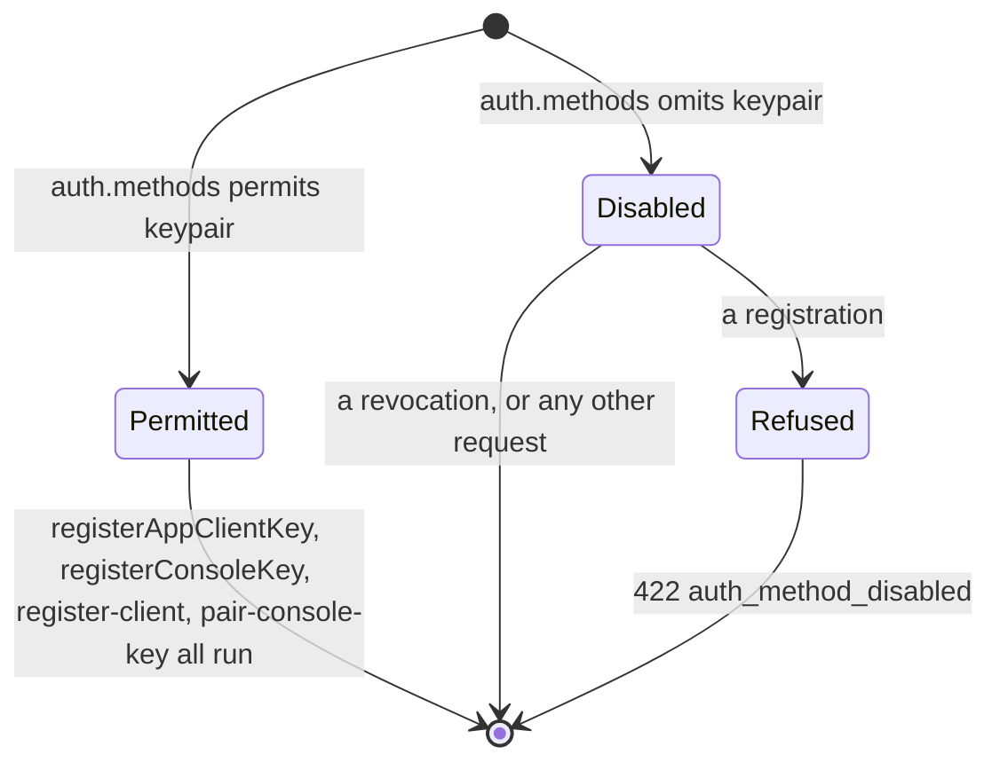

What a deployment that does not permit `keypair` refuses (VSA-3b).

`auth.methods` can leave `keypair` out when `machine_tokens` is permitted (the
list `[machine_tokens]` is legal from VSA-3b). Nothing is then accepted signed:
the envelope layer runs in `Off` mode and answers a request with a `COSE_Sign1`
body with the `415` it has for a payload it will not open
(`crate::envelope::mode_for`). A **key** registered on such a deployment would
look registered and never be honoured, so the two ways of registering one say so
instead:

- over HTTP, `POST /$procs/registerAppClientKey` and `registerConsoleKey` answer
  `422` whose message leads with `auth_method_disabled`
  ([`crate::hmac_gate::AUTH_METHOD_DISABLED`], the word `hmac_webhooks`'
  refusals lead with, so a script switches on one string), through
  [`enforce_keypair_gate`];
- on the command line, `register-client` and `pair-console-key` refuse the same
  way when the configuration they are given does not permit `keypair`
  (`sms-gateway`, `commands/register_client.rs` and `commands/pair_console_key.rs`),
  and point at `provision-client`.

**Pairing a console is unavailable on such a deployment until VSA-5.** A console
key is a signing key, and a person who cannot sign cannot be signed in by one;
the console's sign-in by token is VSA-5's. The gate says so rather than letting a
pairing succeed into a console that cannot use it.

Registration only: `revokeAppClientKey` and `revokeConsoleKey` stay open, so an
operator who turned the method off can still retire the keys it left behind.

<!-- markdownlint-disable-file MD041 -- rustdoc sidecar: include_str!'d as module docs, so it opens with prose, not a heading; at the end so the first paragraph stays rustdoc's summary line -->
