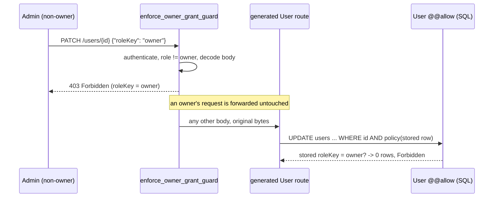

Who may hand out `owner` — the write-path half of a two-part guard.

`owner` is the top of the console's role ladder: only an owner may delete a
`User` or edit a `Role` (`schemas/vsms.cstack`, `model User` / `model Role`).
`User`'s `create`/`update` policy admits `admin` too, and on 2026-10-20 in
production an `admin` updated its **own** record to `roleKey = owner`
(`cratestack_audit`: actor role `admin`, before `admin`, after `owner`).

# Two halves, because the policy engine can only see half of it

- **Schema half** (`schemas/vsms.cstack`): `create` is evaluated against the
  *input*, so `hasRole('admin') && roleKey != 'owner'` refuses an admin
  creating an owner. `update` compiles to `UPDATE … WHERE <policy>` on the
  *stored* row, so the same clause stops an admin editing, demoting or
  deactivating an **existing** owner. It cannot see the **new** value
  (`cratestack-sqlx` `update_exec.rs`: `UPDATE … AND policy(...) RETURNING`,
  no post-write check), so it cannot stop `admin → owner` on its own.
- **This module** is that missing half: [`enforce_owner_grant_guard`]
  authenticates the request, and for any caller whose role is not `owner`
  buffers the body of `POST /users` and `PATCH /users/{id}` and refuses with
  403 when it sets `roleKey` to `owner`.

# Fail closed

- The body is decoded with the *same* transport the router uses
  (`router::ROUTER_CODEC`) into the *same* generated input
  types the handler decodes (`CreateUserInput` / `UpdateUserInput`), choosing
  the codec by `Content-Type` through `cratestack::decode_transport_request_for`
  with the route's own `ROUTE_TRANSPORTS` capabilities. What the guard reads is
  what the handler would act on, including duplicate-key and unknown-field
  behaviour.
- A non-owner's body that cannot be decoded is refused (400, or 415 for a
  `Content-Type` the router has no decoder for — a CBOR body today, since the
  router is JSON-only). The request is never forwarded undecoded.
- A body over `cratestack::DEFAULT_BODY_LIMIT_BYTES` (the router's own cap) is
  refused, not truncated.
- An owner's request is not buffered or inspected: owner may assign any role.
- `system` / `app` principals never reach these routes with a body that sets a
  role; they are treated like any other non-owner.

`POST /$procs/provisionUser` also creates a `User`, but through the delegate
under the caller's own context, so the schema half's `create` clause already
refuses an admin provisioning an owner (proven end to end in
`backends/apps/sms-gateway/tests/login_flow_live_postgres.rs`).

Adding a user-write route (a batch or upsert route, a new codec) means adding
it to `GUARDED_ROUTES` — `every_generated_user_write_route_is_guarded` fails
the build until it is classified.

<!-- markdownlint-disable-file MD041 -->
