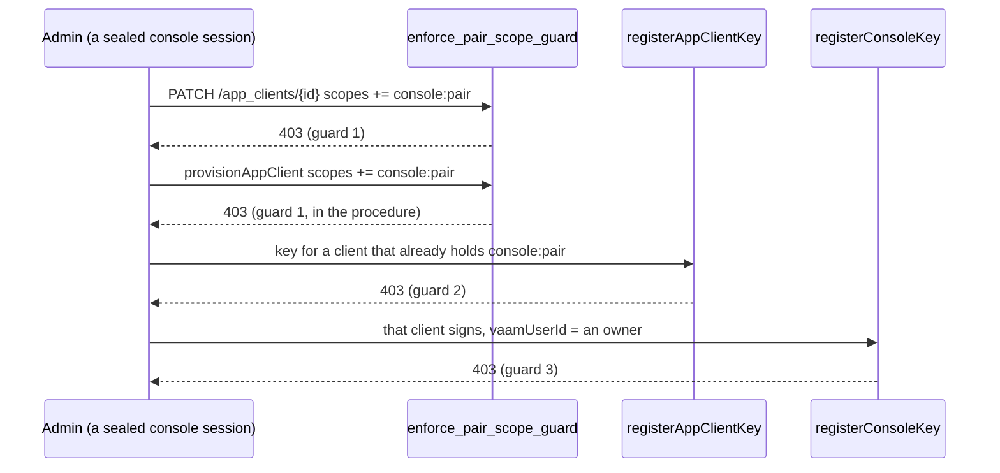

Who may hand out `console:pair` - the guard that keeps a console key from
being an owner's.

A client holding `console:pair` can call `registerConsoleKey` for any person
vaam names and attach a key to them (`console_keys`). Whoever can give a client
that scope, and a key, can therefore sign as any linked person, an owner
included. Three independent guards cut that chain, each enough on its own:

1. **Granting the scope.** [`enforce_pair_scope_guard`] refuses a body that
   names `console:pair` on `POST /app_clients` and `PATCH /app_clients/{id}`,
   for every caller, owner included, and `provisionAppClient` refuses it through
   [`refuse_pair_scope`]. The scope is granted by `sms-gateway register-client
   --scope console:pair`, run by an operator against the database.
2. **Registering a key for such a client**
   ([`crate::client_keys::Registrant`]): only the command line may.
3. **Attaching a console key to an owner** (`console_keys::register`): an owner
   pairs only through `sms-gateway pair-console-key`.

Like [`crate::owner_grant`], the guard decodes the body with the router's own
codec into the route's own generated input type, so what it reads is what the
handler would act on, and fails closed on a body it cannot read.

<!-- markdownlint-disable-file MD041 -->
