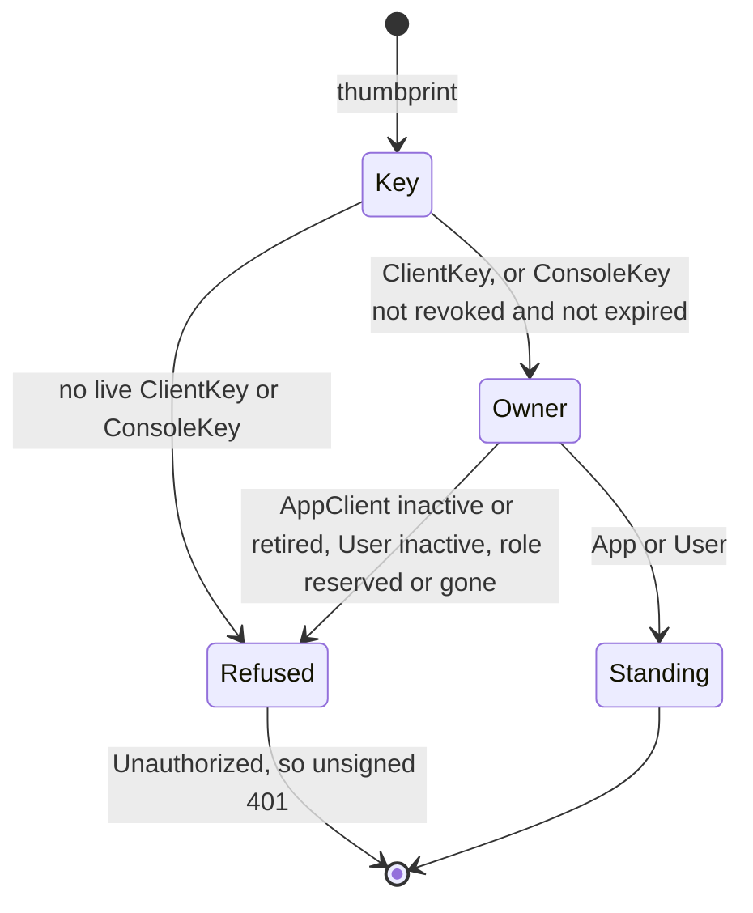

From a verified key to what it may do (VS-3).

The envelope layer proves *who holds the key*; it authenticates no one. This
module answers the two questions that follow, against the database, on every
request:

1. **Is this a key we accept?** [`DirectoryKeys`] is the layer's
   `CoseVerifierResolver`: an Ed25519 message resolves to the non-revoked
   `ClientKey` rows whose thumbprint starts with the message's 8-byte `kid`, an
   ESP256 message to the non-revoked, unexpired `ConsoleKey` rows, and anything
   else (an HMAC message) to nothing. A revoked or expired key therefore fails
   verification and the layer answers its coarse unsigned 401, the same answer
   as a forgery.
2. **What does it stand as?** [`SignerDirectory::standing`] looks the verified
   key up by its full thumbprint and returns an [`AppStanding`] (the
   `AppClient`'s id, app and scopes) or a [`UserStanding`] (the person's role
   and the role's permissions). [`crate::auth::GatewayAuth`] turns that into the
   policy context, and `crate::envelope::SignerPrincipal` into the name the rate
   limiter and the idempotency layer charge the request to.

A machine token is the second way to a [`Standing`]: [`SignerDirectory::bearer_standing`]
reads the `OauthClient` (active, on every request), its `AppClient` (active, not
retired, the token's `sub`) and acts with the `AppClient`'s scopes that the
`OauthClient` row also lists, narrowed by the token's claim when it has one,
never `console:pair` (`bearer.md`).

Nothing about a key is cached. The standing of the key's owner is, for 60
seconds, which is how long a deactivated client or person may keep acting.
Thumbprints of the two key kinds can never collide (an `OKP` and an `EC2`
`COSE_Key` hash differently), so the order of the two lookups is not
load-bearing.

All reads run under the internal system context, which is why `ClientKey`,
`ConsoleKey`, `AppClient`, `User` and `Role` all admit `hasRole('system')` to
read and why the system-context golden list covers them.

<!-- markdownlint-disable-file MD041 -->
