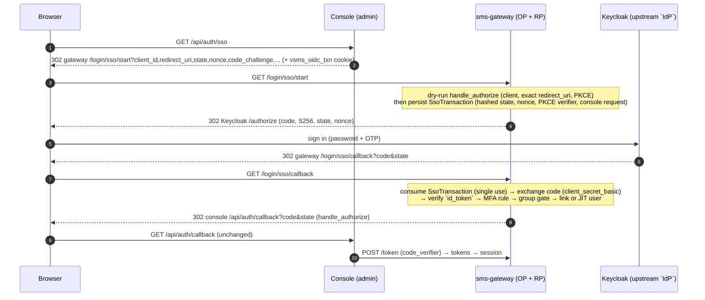

OIDC single sign-on for the admin console, brokered by the gateway.

# The shape: the gateway stays the console's OP

The console and the API never see an upstream token. Every token they handle
is still issued by vsms's own `authkestra` OP, so `GatewayAuth::
authenticate_human`, the `User`/`Role` lookup, and every `@@allow` policy are
exactly what they were. Only the one step the OP could not do for itself -
*who is this human?* - is federated: where `POST /login` answers it with an
Argon2id password check, `GET /login/sso/start` + `GET /login/sso/callback`
answer it by sending the browser to the staff Keycloak realm, verifying what
comes back, and handing the **same** `Identity` to the **same, unmodified**
`authkestra_op::handlers::authorize::handle_authorize`.

# Decisions (owner, 2026-10-19)

- **Provisioning is just-in-time, gated by group.** The first successful
  sign-in of a user in the required `IdP` group creates the vsms `User` if no
  [`FederatedLink`](sms_api::schema::FederatedLink) for `(issuer, sub)`
  exists. **Linking is by `(iss, sub)` only - never by email.** Email and
  name are display data, written once at creation and never used to select
  an account.
- **Roles stay local.** No token claim ever sets or changes a vsms role. A
  JIT user gets one configured least-privilege role ([`DEFAULT_JIT_ROLE`],
  `support`); every later change goes through the console or CLI as it does
  today.
- **MFA is required, by claim.** [`policy`] documents the rule and the
  Keycloak measurements behind it.
- **Password sign-in is untouched** and stays as the break-glass path.
- **One issuer per deployment.** SSO is active when its configuration is
  present - there is no other switch.

# Where each piece lives

| Piece                                             | Module       |
| ------------------------------------------------- | ------------ |
| Config, validation, fail-closed startup rules     | [`config`]   |
| Discovery, JWKS, authorization URL, code exchange | [`provider`] |
| `id_token` verification (pure)                    | [`id_token`] |
| MFA rule, group gate, the one-retry verdict       | [`policy`]   |
| `SsoTransaction`/`FederatedLink` persistence, JIT | [`store`]    |
| The callback's orchestration                      | [`flow`]     |
| Why a refusal looks the same to the browser       | [`error`]    |

The HTTP routes are in the gateway (`backends/apps/sms-gateway/src/sso.rs`),
next to `login.rs`, for the same reason: they are raw axum routes that run
before any bearer token exists.

<!-- markdownlint-disable-file MD041 -- rustdoc sidecar: include_str!'d as module docs, so it opens with prose, not a heading; at the end so the first paragraph stays rustdoc's summary line -->
