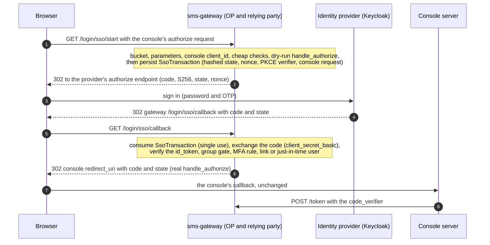

OIDC single sign-on for the console, brokered by the gateway (VSA-4c, restored from
`29f93c4^` and re-based on `human_login.sso`).

# The shape: the gateway stays the console's OP

The console and the API never see an upstream token. Every token they handle is still
issued by vsms's own `authkestra` OP, so the `User`/`Role` lookup and every `@@allow`
policy are exactly what they are for a password sign-in. Only the one step the OP could
not do for itself - *who is this human?* - is federated: where `POST /login` answers it
with an Argon2id password check, `GET /login/sso/start` + `GET /login/sso/callback`
answer it by sending the browser to the staff identity provider, verifying what comes
back, and handing the **same** `Identity` (`provider_id` `sms-console`, `external_id`
the `User.id`) to the **same, unmodified**
`authkestra_op::handlers::authorize::handle_authorize`. So the access token it earns is
that person's at the API (VSA-4b): their role, their permissions, and **never as an
`owner` or an `admin`**, which act only from a paired console key. The cap is on the
role the row says, not on how the person signed in.

# Decisions (owner, 2026-10-19, kept by VSA-4c)

- **Provisioning is just-in-time, gated by group.** The first successful sign-in of a
  user in the required `IdP` group creates the vsms `User` if no
  [`FederatedLink`](sms_api::schema::FederatedLink) for `(issuer, sub)` exists.
  **Linking is by `(iss, sub)` only - never by email.** Email and name are display data,
  written once at creation and never used to select an account.
- **Roles stay local.** No token claim ever sets or changes a vsms role. A JIT user gets
  the one configured role (`human_login.sso.jit_role`), and the groups claim is only a
  gate: an exact match on `required_group`, never mapped to a role. Every later change
  goes through the console or CLI as it does today.
- **MFA is required, by claim.** [`policy`] documents the rule and the Keycloak
  measurements behind it.
- **Password sign-in is untouched** and stays as the break-glass path.
- **One issuer per deployment.** SSO is served when `human_login.sso` is written - there
  is no other switch.

# What VSA-4c added to the first design

- **The configuration is YAML**, not eleven flags: `sms_config::Sso` is validated by the
  loader (`sms-config`'s `human_login.md`, "Rules of `sso`"), and [`SsoConfig`] only
  derives what that block does not say. The redirect URI is **derived**: `op.issuer` +
  [`CALLBACK_PATH`], never written.
- **A confirmed address is required to create an account.** The `id_token` must say
  `email_verified: true` (the JSON boolean - a string is not one), or the sign-in is
  refused (`email_unverified`) and nothing is created. A returning person is found by
  `(iss, sub)` and their email is never read, so this costs them nothing.
- **`.invalid` is reserved.** An address at that top-level domain (RFC 6761) is refused
  (`email_reserved`): console pairing writes `<id>@vaam.invalid` for the accounts it
  creates, and a federated account must not collide with or impersonate one.
- **The JIT role is checked three ways**: the loader refuses it
  (`sms_config::REFUSED_JIT_ROLES`), [`store`] refuses to create an account under it at
  run time (the operator's error, `unavailable`, not a refusal of the person), and the
  database refuses an `owner` from an `admin` creator. The loader's list is a copy of
  `sms_api::auth::RESERVED_ROLE_KEYS` and `DEVICE_ONLY_ROLES`, which `sms-config` cannot
  import, and a test here pins the copy.
- **`lastLoginAt` is stamped by the caller**, once a code is issued
  ([`store::stamp_last_login`]), and a first sign-in creates the account with none:
  resolving an account is not signing it in.

# Where each piece lives

| Piece                                             | Module       |
| ------------------------------------------------- | ------------ |
| Config derived from the loaded block              | [`config`]   |
| Discovery, JWKS, authorization URL, code exchange | [`provider`] |
| `id_token` verification (pure)                    | [`id_token`] |
| MFA rule, group gate, the one-retry verdict       | [`policy`]   |
| `SsoTransaction`/`FederatedLink` persistence, JIT | [`store`]    |
| The callback's orchestration                      | [`flow`]     |
| Why a refusal looks the same to the browser       | [`error`]    |

The HTTP routes are in the gateway (`backends/apps/sms-gateway/src/sso.rs`), next to
`login.rs`, for the same reason: they are raw axum routes that run before any bearer
token exists.

<!-- markdownlint-disable-file MD041 -- rustdoc sidecar: include_str!'d as module docs, so it opens with prose, not a heading; at the end so the first paragraph stays rustdoc's summary line -->
