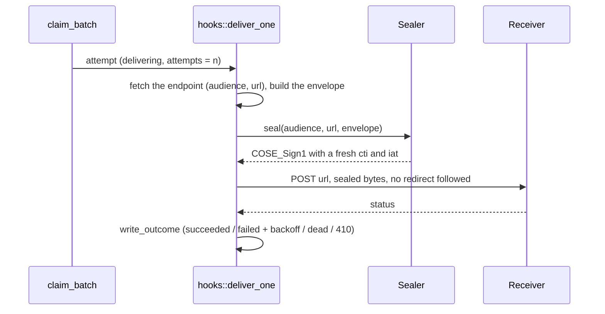

`Role::Hooks`'s real body — #40. Claims due `WebhookAttempt` rows via
[`crate::claim::claim_batch`], delivers each in its endpoint's mode with
`sms-webhook` (`sealed`: a `COSE_Sign1` request, VS-8; `hmac`: the original
`X-Sms-Signature`, #41, kept by VS-8R), and drives `pending`/`failed -> delivering -> succeeded|failed|dead`
per §8.5. `claim.rs`'s own `impl Claimable for WebhookAttempt` owns the
claim half (endpoint-health filtering, the crash-reclaim same-state
write); this module owns everything after a row reaches `delivering`.

# The missing transition table, and the position this PR takes on it

`AttemptState` shipped with #38/#39, but no `attempt_state_transitions`
table or trigger existed — nothing had written `WebhookAttempt.state` yet,
so R2 ("proposed by Rust, decided by Postgres") had nothing to decide
against. #38/#39's own PR left this exactly as open as it found it,
flagging it as the next role's problem. This PR resolves it in favour of
the same discipline `messages`/`jobs` already get — `attempt_state_
transitions` + `attempts_guard_transition` (§2.10, `0002_bootstrap`) —
rather than arguing webhook attempts are somehow exempt from R2. They
aren't: an illegal edge here (a bug in this file, a future admin-console
replay feature, a stray `psql` session) deserves the same SQLSTATE `SM001`
→ `409 Conflict` backstop every other state machine in this system gets,
not a silent write or an opaque `500`.

# What `WebhookAttempt.payload` contains, and what actually gets sent

`payload` (written by `backends/crates/sms-api/src/webhooks.rs`'s subscribers) is
the §8.4 `data` object *only* — not the outer envelope. This module
builds the envelope at delivery time ([`build_envelope`]): `id` from
`WebhookAttempt.id` (the only value that has existed since the row was
created — see `webhooks.rs`'s own doc for why the envelope's `id` can't
be anything else), `eventId` from `sourceEventId` (it used to ride only in the
`X-Sms-Event-Id` header, which the HMAC signed; headers are no part of a seal,
so the id is in the sealed body now), `appId` and `endpointId` from the endpoint
the attempt belongs to (every app's deliveries are signed by the one gateway
key, so a receiver tells a delivery made *for it* from one merely addressed to
its audience by these two, which the seal covers), `type` from `eventType`, `data` from `payload` parsed
back into a JSON value (never re-wrapped as a string — nesting an
already-JSON string inside a JSON string is exactly the kind of "close
but not the contract" bug a receiver's own parser would silently choke
on), and `occurredAt` — see [`build_envelope`]'s own doc for why this is
a documented approximation, not the original event's timestamp.

**What gets sealed is exactly what gets sent — never a second, later
re-serialization of the same logical value.** [`build_envelope`] returns
one `String`; its bytes are what [`sms_webhook::Sealer::seal`] puts inside the
`COSE_Sign1` message, which is what `reqwest` puts on the wire. Sealing
anything else — the parsed `serde_json::Value` re-serialized a second
time by a different call site, say — would be the exact silent bug this
module's own doc warns about: `serde_json::Value`'s map type does not
preserve key order or exact whitespace, so a second serialization is not
guaranteed to produce byte-identical output to the first.

# The mode is the endpoint's, per row (VS-8R)

`WebhookEndpoint.deliveryMode` picks how one attempt is built, and nothing else
about the loop differs: the claim, the status handling (2xx delivered, 410
deactivates, anything else retries with the §8.5 backoff and counts toward the
breaker), `write_outcome` and the 10 s timeout are one path for both. The redirect
policy is the one thing that is not: `sealed` follows none, `hmac` keeps reqwest's
default (`HttpClients`).

|                                                   | `sealed`                                                                   | `hmac`                                                                                                  |
| ------------------------------------------------- | -------------------------------------------------------------------------- | ------------------------------------------------------------------------------------------------------- |
| Body ([`build_envelope`])                         | `{id, eventId, type, occurredAt, appId, endpointId, data}`                 | `{id, type, occurredAt, data}`, what its receivers verify today                                         |
| Authentication                                    | `Sealer::seal(audience, url, body)`, fresh per attempt                     | `sign_header([secret, prevSecret?], timestamp, eventId, body)`, the current secret first                |
| Headers                                           | the seal's `Content-Type` and `Cratestack-*`                               | `X-Sms-Event`, `X-Sms-Event-Id`, `X-Sms-Timestamp`, `X-Sms-Signature`, `Content-Type: application/json` |
| Needs                                             | `WorkerContext::webhook_sealer` (the envelope signing key) and an audience | the endpoint's `secret`                                                                                 |

# A worker without the signing key claims no sealed attempt

A worker with no signing key still starts and still delivers every `hmac`
endpoint, and it does not **claim** a `sealed` attempt at all
([`crate::claim::ServedModes::HmacOnly`]). The mode is decided where the rows are
chosen: the claim reads the endpoints first. When every endpoint is one it may take
attempts from (active, circuit closed, `hmac`) it is the keyed claim's own query;
otherwise it asks `webhook_endpoint_due_idx` for each such endpoint's due attempts,
so its cost follows the `hmac` work (per endpoint, up to `budget` rows each) and
never touches a sealed backlog, however large (`claim.md` has the measurements).
Filtering the rows after fetching them would let a sealed backlog, or a deactivated
endpoint's, fill the window and starve the `hmac` rows behind it. A worker that
holds the key claims both modes by the same rule, leaving out only the endpoints
that are deactivated or whose circuit is open.

Nothing about a sealed row is therefore written by a keyless worker: it stays
`pending` (or `failed`, resting out its backoff), its `attempts` unchanged, its
endpoint's breaker untouched, and a worker that has the key delivers it as soon as
it runs.

**One window is left open, and it is closed after the claim.** The claim chose an
`hmac` endpoint, and an operator can switch it to `sealed`
(`switchWebhookDeliveryMode`) before the worker reads the endpoint again to
deliver. The attempt is then `delivering`, counted by the claim, and this worker
cannot send it. `deliver_one` logs it and returns without writing an outcome,
exactly as for an endpoint that vanished: a failure written here would be a lie,
burning an attempt of `maxAttempts` (`dead` for a `maxAttempts` of 1) and
feeding the breaker for a request never made. The lease expires, a keyless
reclaim skips the row (the endpoint is `sealed` now) and a worker that has the key
resumes it without counting a second attempt.

A row the sealer refuses anyway (a signer that fails, or a row written around
the API: the CHECK on a `sealed` row's URL is a pattern, and it is the pattern
**together with `@uri`**, which every write through the API passes, that never
accepts what the sealer refuses, so a URL put into the table with `psql` can
still reach the sealer) is an ordinary [`Outcome::Retryable`] like any other
failed delivery: counted, backed off, able to open the breaker and to go `dead`.

Rows that wait silently are the cost, so [`SealedBacklogWatch`] pays it: a keyless
`run` counts the due sealed attempts of **active** endpoints (a `COUNT(*)`, due
or abandoned by a crashed worker) every five minutes and, if there are any, logs
a `warn` with the number and `--envelope-signing-key-file`. A deactivated
endpoint's attempts are claimed by no worker, key or not, so they are not
waiting for one; an endpoint whose circuit is open is counted, because the
circuit is a pause that ends by itself. `backends/apps/sms-worker` logs one at
start.

# When `hmac_webhooks` is off (VSA-1)

`auth.methods` is deployment configuration (`sms-config`, `auth.md`), and a
deployment that does not permit `hmac_webhooks` (vaam's `[keypair]`) must not
send with a shared secret, whatever rows exist. `WorkerContext::hmac_webhooks`
carries the answer. `deliver_one` checks it right after reading the endpoint:
an `hmac` endpoint's attempt is **parked** ([`park_hmac`]) and nothing is sent.

```mermaid
stateDiagram-v2
    [*] --> pending: event subscribed
    pending --> delivering: claim (attempts + 1)
    delivering --> failed: park_hmac (attempts restored, lastError delivery_mode_disabled, nextAttemptAt + 1 h)
    failed --> delivering: claim, the hour having passed (method permitted again: delivered; still off: parked again)
    failed --> pending: replayWebhookAttempt
```

What the park does, and the reason for each choice (the owner asked for a stated
choice where the ticket left one open):

- **`failed`, with the reason in `lastError`**, which starts with
  `delivery_mode_disabled`. Not `dead`: dead is the end of the line for an attempt
  that ran out of tries, and this one used none. Not left `pending`: a row nothing
  says anything about is the silent failure this repository does not ship, and the
  console's delivery log shows `lastError`.
- **Replayable**, because `failed` is what `replayWebhookAttempt` accepts and
  nothing else about the row is touched. A replay with the method still off is
  parked again at the next claim.
- **Not counted toward the dead-letter limit.** The claim added one to
  `attempts`; the park takes it back. No `write_outcome` runs, so `maxAttempts` is
  not consulted. The day the method is permitted again the attempt has every try
  it had. (The alternative, leaving it counted, would age a month of parked
  deliveries into `dead` one failure after the method came back.)
- **Not on the endpoint's breaker.** `record_endpoint_failure` is not called: no
  request was made, so the endpoint did nothing wrong, the reasoning
  [`Outcome::MalformedPayload`] already records for our own bugs. `circuitOpenUntil`
  and `consecutiveFailures` are as they were, and no success resets them either.
  There is no reason it must trip: the breaker protects an endpoint from our
  retries, and a parked attempt makes none.
- **Rests an hour** ([`PARK_INTERVAL`]) rather than being due at once, or the
  worker would rewrite every parked row each second. After an hour a claim looks
  again: if the method is permitted by then (changing `auth.methods` is a
  restart) the delivery goes out on its own, and if not it is parked again.
  The cost with the method off is one small write per parked attempt per hour.
- **Claimed first, then parked, not left unclaimed** the way a keyless worker
  leaves a sealed attempt ([`crate::claim::ServedModes`]). A worker that cannot
  send a sealed attempt is missing a *key*, which a different worker has, so
  recording nothing is honest: the attempt waits for that worker. Nobody can send
  this one, and the operator has to be told why: writing the reason onto the row is
  how the console shows it.
- **The sealed attempts beside them are unaffected** and delivered as before: the
  gate is per endpoint, on the endpoint's own mode.

A `warn` names the endpoint, at most every ten minutes, and `run` logs once at
start how many `hmac` endpoints exist (`sms_api::HmacBoot`,
the line `serve` logs too). The API side, which refuses to create, switch to or
rotate one, is `sms-api`'s `hmac_gate.md`.

# Redirects

`build_http_client` builds an `HttpClients` pair. The `sealed` client follows
none: a `307` would re-send bytes sealed for one audience to another host, and is
an ordinary failed attempt. The `hmac` client keeps reqwest's default policy
(up to ten hops, a `307`/`308` re-sending the signed body), exactly as the
pre-sealed worker did, because other apps' receivers sit behind redirects and the
HMAC scheme is kept unchanged for them. The SSRF-shaped caveat is the old one:
whoever controls an `hmac` receiver's redirects controls where its deliveries
go. Both carry the same 10 s timeout. `hooks_live_postgres.rs` proves each.

# Sealing, per attempt (VS-8)

A retry runs this whole path again: **every attempt is sealed afresh**, so a
retry after the receiver's 300 s skew still opens and a re-sent nonce is never
what a receiver sees. The endpoint's `audience` is what the seal binds as the
recipient; the route is the path of its `url` (`sms_webhook::delivery_route`).
A delivery that cannot be sealed never reaches the network and is an ordinary
[`Outcome::Retryable`]. The signing key is `WorkerContext::webhook_sealer`, loaded
from `--envelope-signing-key-file`; with none, the worker claims no `sealed`
attempt (above) and `hmac` endpoints are unaffected. The receiver's answer is judged by status alone and
never opened (`sms-webhook`'s `lib.md`, "The answer"). A sealed delivery follows
no redirect.

# `maskRecipient` — enforced upstream, not re-derived here

§4.4/§8.4: an endpoint configured for masked recipients must never see a
plaintext MSISDN. That masking happens once, at insert time, in
`backends/crates/sms-api/src/webhooks.rs::message_payload` — `payload`'s `to`
field is already whatever the matched endpoint's `maskRecipient` called
for by the time this module ever reads the row. This module's own
correctness obligation is narrower but just as real: never reconstruct
or enrich that value from anything else this crate can reach (the
`Message` row, if this crate ever gained a reason to read one here) —
[`build_envelope`] parses `payload` into a `data` object and embeds it
verbatim, touching no field of it individually, so there is no code path
by which a plaintext MSISDN could re-enter the outbound body even by
accident. `hooks_live_postgres.rs`'s `mask_recipient_payload_is_forwarded_
verbatim_never_reconstructed` test proves this against a real HTTP
capture, not just by reading this paragraph.

<!-- markdownlint-disable-file MD041 -- rustdoc sidecar: include_str!'d as module docs, so it opens with prose, not a heading; at the end so the first paragraph stays rustdoc's summary line -->
