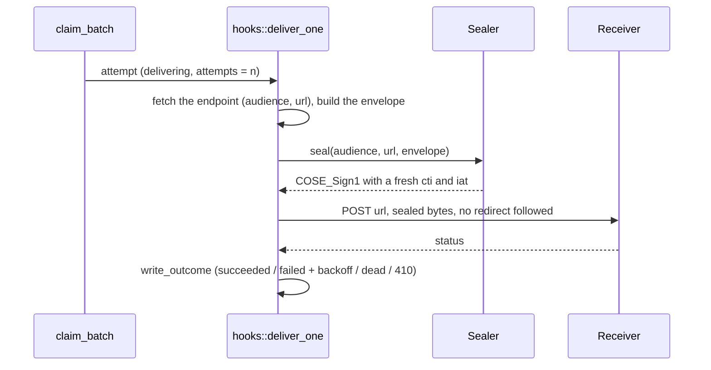

`Role::Hooks`'s real body — #40. Claims due `WebhookAttempt` rows via
[`crate::claim::claim_batch`], seals and POSTs them with `sms-webhook`
(VS-8; an HMAC signature until then, #41), and drives `pending`/`failed -> delivering -> succeeded|failed|dead`
per §8.5. `claim.rs`'s own `impl Claimable for WebhookAttempt` owns the
claim half (endpoint-health filtering, the crash-reclaim same-state
write); this module owns everything after a row reaches `delivering`.

# The missing transition table, and the position this PR takes on it

`AttemptState` shipped with #38/#39, but no `attempt_state_transitions`
table or trigger existed — nothing had written `WebhookAttempt.state` yet,
so R2 ("proposed by Rust, decided by Postgres") had nothing to decide
against. #38/#39's own PR left this exactly as open as it found it,
flagging it as the next role's problem. This PR resolves it in favour of
the same discipline `messages`/`jobs` already get — `attempt_state_
transitions` + `attempts_guard_transition` (§2.10, `0002_bootstrap`) —
rather than arguing webhook attempts are somehow exempt from R2. They
aren't: an illegal edge here (a bug in this file, a future admin-console
replay feature, a stray `psql` session) deserves the same SQLSTATE `SM001`
→ `409 Conflict` backstop every other state machine in this system gets,
not a silent write or an opaque `500`.

# What `WebhookAttempt.payload` contains, and what actually gets sent

`payload` (written by `backends/crates/sms-api/src/webhooks.rs`'s subscribers) is
the §8.4 `data` object *only* — not the outer envelope. This module
builds the envelope at delivery time ([`build_envelope`]): `id` from
`WebhookAttempt.id` (the only value that has existed since the row was
created — see `webhooks.rs`'s own doc for why the envelope's `id` can't
be anything else), `eventId` from `sourceEventId` (it used to ride only in the
`X-Sms-Event-Id` header, which the HMAC signed; headers are no part of a seal,
so the id is in the sealed body now), `type` from `eventType`, `data` from `payload` parsed
back into a JSON value (never re-wrapped as a string — nesting an
already-JSON string inside a JSON string is exactly the kind of "close
but not the contract" bug a receiver's own parser would silently choke
on), and `occurredAt` — see [`build_envelope`]'s own doc for why this is
a documented approximation, not the original event's timestamp.

**What gets sealed is exactly what gets sent — never a second, later
re-serialization of the same logical value.** [`build_envelope`] returns
one `String`; its bytes are what [`sms_webhook::Sealer::seal`] puts inside the
`COSE_Sign1` message, which is what `reqwest` puts on the wire. Sealing
anything else — the parsed `serde_json::Value` re-serialized a second
time by a different call site, say — would be the exact silent bug this
module's own doc warns about: `serde_json::Value`'s map type does not
preserve key order or exact whitespace, so a second serialization is not
guaranteed to produce byte-identical output to the first.

# Sealing, per attempt (VS-8)

A retry runs this whole path again: **every attempt is sealed afresh**, so a
retry after the receiver's 300 s skew still opens and a re-sent nonce is never
what a receiver sees. The endpoint's `audience` is what the seal binds as the
recipient; the route is the path of its `url` (`sms_webhook::delivery_route`).
A delivery that cannot be sealed never reaches the network and is an ordinary
retryable failure. The signing key is `WorkerContext::webhook_sealer`, loaded
from `--envelope-signing-key-file`; with none, the role refuses to start and
`tick` claims nothing. The receiver's answer is judged by status alone and
never opened (`sms-webhook`'s `lib.md`, "The answer"). Redirects are not
followed.

# `maskRecipient` — enforced upstream, not re-derived here

§4.4/§8.4: an endpoint configured for masked recipients must never see a
plaintext MSISDN. That masking happens once, at insert time, in
`backends/crates/sms-api/src/webhooks.rs::message_payload` — `payload`'s `to`
field is already whatever the matched endpoint's `maskRecipient` called
for by the time this module ever reads the row. This module's own
correctness obligation is narrower but just as real: never reconstruct
or enrich that value from anything else this crate can reach (the
`Message` row, if this crate ever gained a reason to read one here) —
[`build_envelope`] parses `payload` into a `data` object and embeds it
verbatim, touching no field of it individually, so there is no code path
by which a plaintext MSISDN could re-enter the outbound body even by
accident. `hooks_live_postgres.rs`'s `mask_recipient_payload_is_forwarded_
verbatim_never_reconstructed` test proves this against a real HTTP
capture, not just by reading this paragraph.
