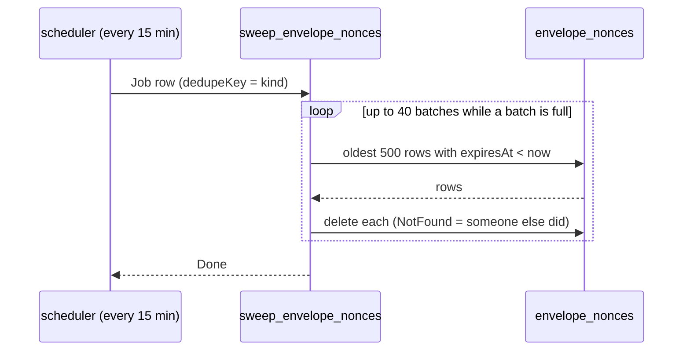
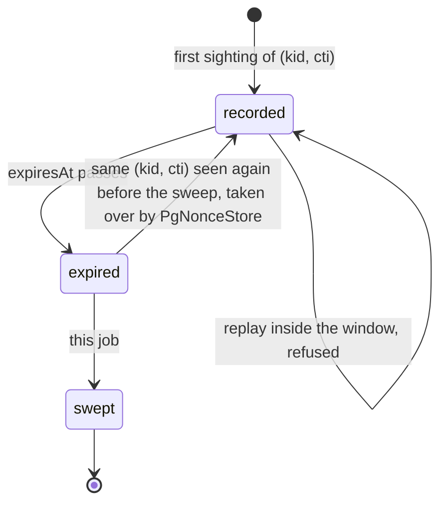

`sweep_envelope_nonces` (VS-3). Deletes the rows of `EnvelopeNonce` whose
`expiresAt` has passed.

The signed transport's envelope layer records each accepted request's
`(kid, cti)` until `iat + 2 * skew + 1`, which is 601 seconds at cratestack's
300-second default skew (the second `skew` is the margin for the replicas and
the store disagreeing about the time). After that
instant the request is refused on `iat` freshness whether or not the row is
still there, so keeping it only grows the table: one row per request, forever.
This job is the whole retention mechanism; nothing upstream sweeps, because
cratestack has no Postgres nonce store (`sms_api::envelope::PgNonceStore` is
this deployment's own).

# Why every 15 minutes, in bounded batches

The working set is the window (about ten minutes of requests); sweeping every
quarter hour keeps the table within roughly twice that. Each run deletes at
most 500 rows per batch and 40 batches, so a backlog left by a worker outage
clears over several runs rather than in one long statement. The deletes go
through the generated delegate, one by one, because the delegate has no
`delete_many` and R1 forbids raw SQL here; a row already gone is not an error.

**The sweep's throughput is coupled to the source limiter.** One run deletes at
most 500 x 40 = 20 000 rows every 15 minutes, about 22 rows a second, and the
table gains one row per accepted request. Accepted requests are bounded by the
coarse per-source limiter in `sms_api::router` (burst 1200, refilling 10 a second
per peer address), and this deployment has two peers (Caddy, and `admin` talking
to the gateway directly), so the sustained inflow is at most about 20 a second
and the sweep keeps up. A deployment with more peers, or a raised
`api.source_rate_limit`, can outrun it: raise `MAX_BATCHES`, or run the job
more often, before raising the source budget past 22 requests a second in total.
The table only grows meanwhile, it is never wrong: an expired row left behind is
taken over by `PgNonceStore`, not refused.

# Under which context

The internal `system` context the jobs role runs under: `EnvelopeNonce`
admits `hasRole('system')` for read, create and delete, and nothing else.

<!-- markdownlint-disable-file MD041 -->
