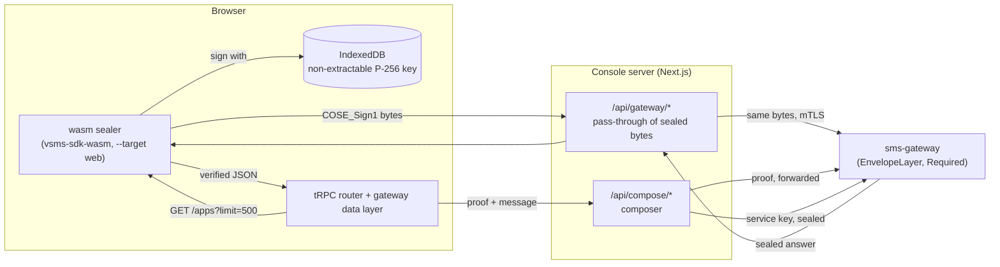
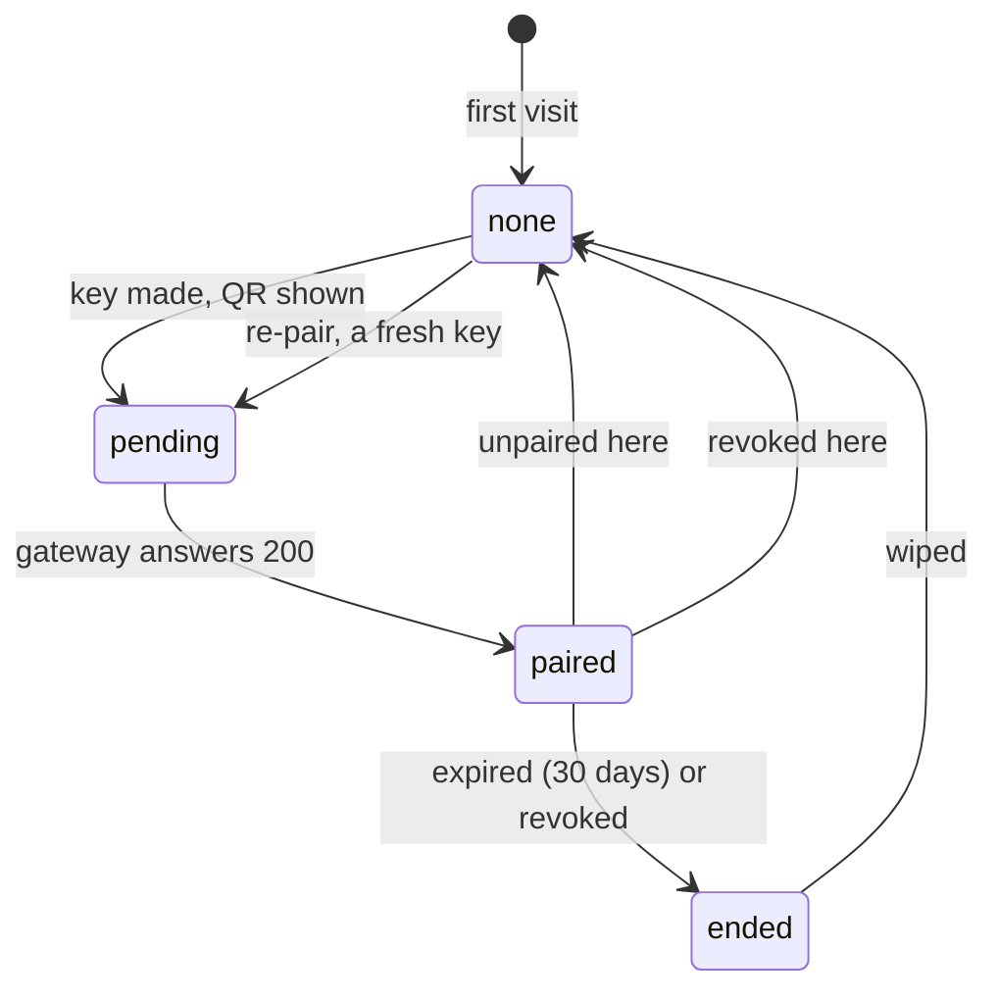

# The console signs in the browser (VS-5b)

**Status:** built. The operator console has no login. A browser makes a key it cannot export, a
vaam admin phone (or, as the break-glass, an operator on the command line) vouches for it, and the
key signs every request the console makes. The console's OpenID, session and single-sign-on
plumbing is deleted, with no compatibility mode.

This is the console half of the signed transport (`docs/architecture.md` §4.0, `docs/integrating.md`).
The gateway half is VS-5a (`ConsoleKey`, `registerConsoleKey`, `pair-console-key`,
`backends/crates/sms-api/src/console_keys.md`) and VS-3 (the envelope that verifies it).

## The rulings this implements

- *"NEVER we should use access or refresh tokens. … We'll use ONLY keypair for signing."* and *"vpay
  and vsms too — keypairs everywhere."* (2026-09-29).
- *"Admin rights only via admin phone pairing"* (2026-10-09).
- Q1 (2026-10-26): phone pairing only, so Keycloak single sign-on and password/TOTP are gone from the
  console. Q2: the break-glass is command-line key enrolment. Q5: the composer keeps its own Ed25519
  service key, registered as an `AppClient` key.
- R2: a paired console user is `admin`, never `owner`. R3: a console key lasts 30 days. R4: the
  console stays optional; the gateway never depends on it.
- No dropdown menus and no dialogs in anything new here (vaam's rule, which binds this product's
  interfaces too): the console's confirmations are inline, its choices are buttons.

## What runs where



Everything left of the console server runs in the page. That is the change: the screens' data layer
(`@vsms/gateway`) and the tRPC router (`@vsms/api`) used to run in the console's server, which held a
credential and called the gateway on the operator's behalf. A server cannot sign with a key that
lives in someone's browser, so the code that decides what to call moved to where the key is. The
tRPC wire protocol is unchanged (batching, superjson, the error formatter that carries a validation
error's per-field detail): `@vsms/hooks` serves it from tRPC's own fetch adapter on an in-process
`fetch` (`createLocalFetch`), so no route handler stands between a screen and the data layer.

The console's server holds **no credential for a person and no session**. It carries sealed bytes
(`app/api/gateway`) and spends one service key, the composer's (`app/api/compose`). `middleware.ts`,
`lib/{oidc,session,sso,sso-discovery}.ts`, `app/api/auth/*`, `app/login/*` and `app/api/trpc` are
deleted; `ADMIN_BASE_URL`, `SMS_AUTH_ISSUER`, `SMS_CONSOLE_CLIENT_ID`, `SMS_CONSOLE_PRIVATE_KEY_PATH`,
`SMS_CONSOLE_SCOPE`, `SMS_CONSOLE_OIDC_CLIENT_ID` and `SMS_CONSOLE_SESSION_SECRET` are gone from the
environment schema, `turbo.jsonc`, both `.env.example` files, the compose stacks and the Helm chart.

## The browser key

`lib/device-key.ts`. `crypto.subtle.generateKey({name: "ECDSA", namedCurve: "P-256"}, false, ["sign",
"verify"])` makes the pair; `extractable: false` makes the private half unexportable in every format
(a test asks for `pkcs8` and `jwk` and is refused, on the key as generated and on the copy that comes
back out of IndexedDB). The `CryptoKey` object itself is stored in IndexedDB by structured clone,
which is the only way a non-extractable key is stored at all. No key material is ever a string, a
cookie or a `localStorage` value.

The record beside the key remembers when the gateway first accepted it and when it expires, because
the gateway cannot tell a key it never knew from one it has finished with (both are its unsigned
401). Only the browser can say "this console *was* paired", which is what lets it ask to pair again
instead of waiting.

## The pairing QR

`lib/pairing.ts`. vaam's admin-pairing format (`backend/src/procedures/admin_pairing.rs`), so one
scanner reads both:

```json
{"v":1,"k":"<65-byte uncompressed P-256 point, base64url>","t":1700000000,"l":"Chrome on macOS","s":"<r‖s, base64url>"}
```

`s` is the key's ECDSA-P-256-SHA-256 signature over the UTF-8 bytes
`"vsms.console-pair.v1\n" + k + "\n" + t`, exactly what `registerConsoleKey` verifies
(`console_keys::possession_message`). A test verifies the QR the way the gateway does, with Node's
`crypto` from the public point alone, and also shows that the signature does not stand for vaam's own
`vaam.admin-pair.v1` message, that a changed `t` or `k` fails, and that five minutes either side of
`t` is the window.

Two things to know:

- **The label is not signed.** vsms's message has no slot for it (vaam's own has). `l` is the
  browser's unauthenticated claim; the phone must show it as one.
- **The QR does not say which service it is for.** A vsms console QR and a vaam admin-browser QR have
  the same shape and differ only in the tag under `s`. Scanned by the wrong flow, the proof fails
  closed. VA-4 has to decide how its scanner routes (a distinct field, a distinct entry, or trying
  both); this side added no field because the format was to match vaam's exactly.

## How pairing completes

```mermaid
sequenceDiagram
    participant B as Console (browser)
    participant S as Console server
    participant G as sms-gateway
    participant O as Operator
    participant P as vaam admin phone
    participant V as vaam
    B->>B: make non-extractable key, store in IndexedDB
    B->>B: draw QR (k, t, l, s); redraw every 4 min
    loop every 2 s until 200
        B->>S: sealed GET /sender_ids?fields=id&limit=1
        S->>G: same bytes
        G-->>B: unsigned 401 (key unknown): "not paired yet"
    end
    alt before VA-4: break-glass
        O->>G: sms-gateway pair-console-key --user EMAIL --public-key k
    else after VA-4: vaam relays
        P->>B: scan the QR
        P->>V: approve with biometrics
        V->>G: registerConsoleKey(vaamUserId, k, s, t)
    end
    B->>S: sealed GET (next poll)
    S->>G: same bytes
    G-->>B: sealed 200
    B->>G: sealed GET /console_keys?thumbprint=...
    G-->>B: id, userId, pairedAt, expiresAt
    B->>B: remember them; open the console
```

The wait is a sealed read the key just made, and the gateway's `200` is the only thing that ends it.
A `401` is "not paired yet", never an error, and neither is a dropped connection (the page says it
cannot reach the gateway and keeps going). The console works the same before and after VA-4: it
cannot tell a command-line enrolment from a phone's, and does not need to.

Before VA-4 the page tells the operator the command and which field of the QR is the key. Pairing
through the command line attaches the key to an **existing** user (`provision-user` makes one); it
creates no user and changes no role, so it cannot mint an owner, but it can attach to one, which is
the owner's way in.

## Sealing

`sdks/rust/vsms-sdk-wasm`, the crate the Node SDK already seals through, is built a second time with
`wasm-bindgen --target web` (`bash sdks/node/vsms-sdk-node/scripts/build-wasm.sh --web`, the admin
package's `build:sealer`) into the gitignored `public/sealer/`, served by the console's own origin
and imported by URL at run time, never bundled. The same pinned `wasm-bindgen` as the Node build;
the script checks it against `sdks/rust/Cargo.lock`.

`Sealer.fromEsp256Callback(publicKey, sign, current, next)` gets a callback that calls
`crypto.subtle.sign`; the key never enters the module, which checks that the signature verifies under
the public key before using it and normalises WebCrypto's raw `r‖s` to the low-`s` form the gateway
requires. The two server keys are pinned as configuration (`SMS_ENVELOPE_SERVER_KEY_CURRENT` and
`_NEXT`, public values from `sms-gateway server-keys`), read by the root layout per request and
handed to the browser, so one image promotes through environments.

Two additions to the crate, both needed by a console that speaks REST with optimistic locking:

- **`routeOf(method, path)`** returns the schema's route template and decoded parameters for a
  concrete path (the matching the test responder already did, promoted and tested). The data layer
  writes ordinary requests (`PATCH /providers/p1`); the sealer is handed the template and parameters,
  rebuilds the target from the very parameters it bound, and the sealing `fetch` drops the request
  unless that target equals the path it was asked for. A request cannot be signed for `m1` and sent
  to `m2`.
- **`sealCall(…, ifMatch)`**. A write under `@version` sends `If-Match`, and the gateway rebuilds the
  binding from the header it receives, so the client has to have bound that value. Without this every
  `PATCH` and `DELETE` of the console would fail verification. The Rust tests seal a `PATCH` with an
  `If-Match` and show that a changed value, and an `If-Match` nobody signed, are both refused by
  cratestack's own server envelope.

### What goes over the wire

`lib/sealing.test.ts` runs the real data layer against a real sealed verifier and asserts, for a read,
a `PATCH` under `If-Match`, a `DELETE`, a `POST` and a procedure: the request is a `POST` to
`/api/gateway/<path>` whose body is a COSE message (CBOR tag 18); the only headers are the ones a seal
depends on plus `x-vsms-method`; there is **no `Authorization` and no cookie**; `credentials` is
`omit`. A sealed `GET` carries its message as the body, which `fetch` refuses, so the browser posts
the bytes and names the real method; the pass-through replays them under it, with `node:http` rather
than `fetch` for the same reason.

The pass-through (`@vsms/gateway/bff`, `app/api/gateway/[...path]/route.ts`) is a pipe whose rules are
pure functions with tests: a `POST` of a COSE message, one of four methods, an allow-list of request
headers (no credential on it), no route the gateway leaves unsealed (`/dlr`, `/healthz`, `/readyz`,
the OpenID routes, the login pages), no dot segment, 1 MiB in and 8 MiB out, no redirect followed, no
`Set-Cookie` or `Location` back. A sealed `204` still has a body and a response cannot be a `204` and
have one, so it travels as a `200` with `x-vsms-status`; the seal binds the status, so a header that
lied about it would make the answer fail to open.

### What comes back is believed only if it opens

`openResponse` verifies the answer under one of the two pinned keys and against this very request.
Refused, by test: plain JSON whatever its status (becomes a `503` of the console's own, and what the
body said never reaches a screen); a body dressed as sealed that is not; a real answer to a *different*
request; an answer sealed under a key that is not pinned. The gateway's unsigned `401` is read as "not
paired", reported once, and **never retried**: a retry is a new request with a new nonce, and a key the
gateway does not know is not one a second attempt can fix. The `ETag` a write sends back is rebuilt
from the signed body's `version`, not copied from a header the seal does not cover.

## The composer

`previewMessage` and `sendMessage` are procedures only an *app* may call
(`backends/crates/sms-api/src/procedures.rs`, `caller_client_id`), so a paired person's key cannot.
The composer (`app/api/compose/[operation]`, `@vsms/gateway/bff` `composer.ts`) sends through a
service key of the console's own: an Ed25519 key registered as an `AppClient` key, read from
`SMS_COMPOSER_KEY_FILE`, signing through the Node SDK, which believes only answers that verify. Q5.

A standing key must not be spent on whoever reaches the route, and there is no session to ask. So the
browser attaches a **proof**: one cheap sealed read (`GET /sender_ids?fields=id&limit=1`, admitted to
any user) made with its own key. The route forwards those bytes and goes on only if the gateway
answers `200`, which it does for a paired, unexpired, unrevoked console key and for nothing else. By
test: a stranger's key, a replayed proof (the gateway refuses a nonce it has seen), a proof of some
other read (the route is bound into the signature) and a malformed body each leave the service key
unused.

The limit, stated plainly: the proof is not bound to the message. It shows that a paired operator's
browser is making the call, not what they typed. Anyone who can make the browser sign can already sign
anything, so binding it would add ceremony and no protection.

R4 holds: the gateway never calls the console, and the service key is useful without it (any
deployment can send with the SDK and the same `register-client` flow).

## The key's life



`lib/key-lifecycle.ts` joins IndexedDB, the gateway and the clock: *none* (no key), *pending* (a key
the gateway has not accepted), *paired*, *ended* (accepted once, refused now, or past its 30 days on
the clock alone), *unreachable* (the gateway could not be reached, which must never read as "not
paired" and send a person with a good key to make a new one).

- **Show it.** `/console` ("This console", under Admin) shows who the key speaks as, its RFC 9679
  thumbprint (`lib/thumbprint.ts`, SHA-256 of the key's CBOR map, **not** of the raw point), when it
  was paired and when it expires, with a warning in the last seven days. The account block shows
  "Paired, 12 days left" everywhere. A console that is not paired shows the pairing page.
- **Re-pair after expiry.** A key is never extended. When it ends the page says so and `/pair` wipes it
  and makes a fresh one.
- **Revoke** calls `revokeConsoleKey` on the user's own key, then forgets it: the gateway stops
  accepting it everywhere. **Unpair** only wipes the IndexedDB key; the gateway's row stays until it
  expires or is revoked elsewhere, which the confirmation says. Both ask inline first.
- **Clock.** Every sealed request carries its signing time and the gateway refuses one more than five
  minutes off its own clock. A laptop with a wrong clock looks "unpaired" (the same unsigned 401), so
  the pairing page measures its clock against the console server's `Date` header and says so past two
  minutes.

## What a stolen browser profile gets

The private key cannot be copied out of the profile as bytes, but a script running *on a page of this
console* can ask it to sign while the page is open. So the exposure is: use of the key by code that runs
in the page, for the key's remaining life, as an `admin`. It is bounded by the 30 days, by role (never
`owner`: an owner can only be enrolled from the command line, and a linked owner is refused by
`registerConsoleKey`), by revocation from any other paired console, and by the fact that the gateway
re-checks the key, the user's `active` flag and the role on every request. What this change does **not**
add is a per-request Content-Security-Policy (`script-src 'self' 'wasm-unsafe-eval'` with a nonce), the
control that keeps injected script out of the page. The static hardening headers are set
(`next.config.ts`); the policy is the follow-up, and the wasm and the `public/sealer/` layout were
chosen so it can say `script-src 'self'` without `unsafe-eval` beyond WebAssembly.

## Configuration

| Variable                          | Where  | What                                                                     |
| --------------------------------- | ------ | ------------------------------------------------------------------------ |
| `SMS_API_URL`                     | server | the gateway; with `https:`, all three certificate paths below            |
| `SMS_API_CLIENT_CERT_PATH`        | server | mTLS client certificate from the console's process to the gateway        |
| `SMS_API_CLIENT_KEY_PATH`         | server | its key                                                                  |
| `SMS_API_CA_PATH`                 | server | the CA that signed the gateway's certificate                             |
| `SMS_ENVELOPE_SERVER_KEY_CURRENT` | server | the gateway's current sealing public key (`sms-gateway server-keys`)     |
| `SMS_ENVELOPE_SERVER_KEY_NEXT`    | server | the next one; must differ                                                |
| `SMS_COMPOSER_KEY_FILE`           | server | Ed25519 PKCS#8 PEM of the composer's service key (optional)              |
| `MESSAGE_STREAM_POLL_MS`          | server | the Messages screen's poll window; the other tuning values are unchanged |

The server keys reach the browser as props from the root layout, which opts out of static rendering
(`connection()`), so a build never bakes one environment's keys into an image promoted to another.

## Provisioning the composer's key

`docs/runbooks/deployment.adoc`, "The composer's key", is the procedure. In short: generate an Ed25519
key (`openssl genpkey -algorithm ed25519`), register its public half with `sms-gateway register-client
--app <slug> --client-name console-composer --scope sms:send --scope sms:read --public-key <base64url>`,
and mount the PEM at `SMS_COMPOSER_KEY_FILE`. The private half never reaches vsms. The console's scope
picker deliberately does not offer `console:pair` (the gateway refuses it everywhere but the command
line, `backends/crates/sms-api/src/pair_scope.md`).

## How it was verified

- **Rust** (`sdks/rust/vsms-sdk-wasm`): 38 native tests and 2 doctests against cratestack's own server
  envelope, including `routeOf` for every route of the schema and the `If-Match` binding; `clippy
  -D warnings` for the host and for `wasm32-unknown-unknown`, with and without `responder`.
- **Console** (`frontends/apps/admin`, `pnpm test`, which first builds `.sealer-test/`, the browser
  module with the server half compiled in): the key is non-extractable and stays so through IndexedDB
  (`fake-indexeddb`); the QR verifies under its tag; the thumbprint is RFC 9679's; every outbound call
  is sealed and credential-free; an unsealed, forged, mismatched or unpinned answer is refused; the
  composer is gated by the proof; the status machine, the pairing flow and the clock check.
- **Gateway package** (`@vsms/gateway`): the pass-through's rules, the upstream transport against a real
  local HTTP server (a `GET` with a body, a redirect not followed, the size cap, the timeout), and the
  sealing `fetch`'s own logic.
- **A real `sms-gateway serve`** (2026-10-27; no GitHub job does this, and nothing in the repository drives a
  browser, so the run is recorded here rather than kept as a test). A scratch Postgres 16 cluster, `sms-migrate`,
  `sms-gateway bootstrap`, `create-app --slug acme`, two generated envelope keys with `serve`, and two registered
  Ed25519 clients: the composer's (`register-client --client-name console-composer`) and a stand-in for vaam's pairing
  client (`--client-name vaam-pairing --scope console:pair`). The console was the production build
  (`next build`, standalone, `public/sealer/` from `build-wasm.sh --web`) driven by Playwright's Chromium. 19 of 19
  steps passed:
  - the QR drawn in the page, decoded from its rendered SVG, was relayed by the stand-in as `registerConsoleKey`
    (`publicKey = k`, `possessionProof = s`, `issuedAt = t`): the real backend accepted the possession proof and made an
    `admin` user, and the console opened by itself;
  - `/console` showed the thumbprint the Rust gateway stored (`console_keys.thumbprint`), so `lib/thumbprint.ts` and
    `cratestack::cose` agree; the row's expiry is `paired_at + 30 days`; the Apps screen showed the App the gateway
    sealed;
  - the composer's preview went browser, proof, console, real gateway (proof verified), SDK with the service key, real
    `previewMessage`, `200`; `send` was refused by the gateway's own rule (`sender id "ACME" has no approved provider
    registration`), relayed with its `422` and `VALIDATION_ERROR` intact, and a proof used twice was refused the second
    time. A delivered send needs the registration steps of `just demo`, which this run did not do;
  - Revoke called the real `revokeConsoleKey` (`revoked_at` set) and sent the console back to `/pair` with a fresh key;
    `pair-console-key --user owner@vsms.local` then paired the same browser as the owner;
  - through the console's pass-through to the real gateway, with a WebCrypto non-extractable key from Node: a sealed
    `GET /apps`, a `PATCH` with `If-Match` (accepted by the real `EnvelopeLayer`: the bound header is the one it
    rebuilds), the same `PATCH` stale (a sealed `412` that opens), a `POST` and a `DELETE` under `If-Match`. The real
    `DELETE` answered a sealed `200`, so the `x-vsms-status` carrier for a bodiless status has not yet been exercised by
    a real answer; it is covered by the tests and costs nothing;
  - no request carried an `Authorization` or a `Cookie` at any hop, and the gateway answered a request nobody signed
    with its coarse `401`.
- **A browser run against a stand-in gateway** (cratestack's real server envelope behind `node:http`) preceded that
  and found two defects no unit test could (the status reader's probe notifying itself in a loop, and the page
  navigating before the shared status said "paired"); it also covered a key ended on the gateway elsewhere (the
  console went to `/pair` and said why), a forged unsealed answer for `/apps` (never shown), and the key in IndexedDB
  being non-extractable in a real Chromium.
- **Not run:** `just all-checks`'s `lint` and `test` (the Rust workspace under `backends/` is unchanged and a full
  build did not fit the machine; the wasm crate's own tests and clippy, `cargo deny` for its manifest and every
  `cargo xtask` guard in that recipe did run), a Docker build of the admin image, `helm template`, the compose stacks,
  and a real phone (VA-4 does not exist yet).
